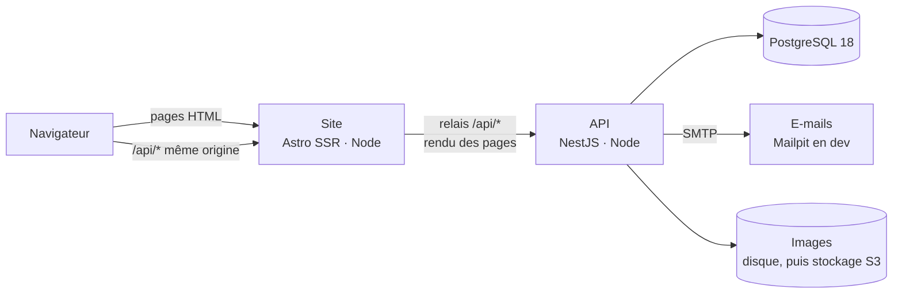

# Architecture de Vysora

> Document vivant. Il décrit ce qui existe et la direction prise ; chaque session le corrige quand la réalité change.
> Les choix structurants sont justifiés dans [`decisions/`](decisions/README.md).

## 1. Vue d'ensemble

Vysora est une application web communautaire : un **site** rendu côté serveur qui reproduit fidèlement le prototype, une **API** qui porte toutes les règles de gestion, une **base PostgreSQL**. La plateforme n'appelle aucun modèle d'IA (C-02, PR-07).



| Bloc | Rôle | Ne fait pas |
|---|---|---|
| `apps/web` (Astro) | Rend chaque page du prototype en HTML côté serveur, avec les données de l'API ; scripts de page pour les interactions ; relais `/api/*` vers l'API. | Aucune règle de gestion, aucun accès direct à la base. |
| `apps/api` (NestJS) | Seule porte d'accès aux données et **seule autorité** sur les droits et les règles (RG-xx) ; authentification, validation, e-mails, tâches. | Aucun rendu HTML. |
| `packages/shared` | Vocabulaire commun : énumérations du MCD, règles chiffrées, droits (`raisonRefus`), schémas Zod, contrats des réponses. | Aucun effet de bord, aucune dépendance au framework. |
| PostgreSQL | Données, contraintes d'intégrité (CI-xx), recherche plein texte (`vysora_fr`). | — |

## 2. Stack technique de départ

Versions installées au démarrage du projet (octobre 2026) ; les mises à jour mineures se font librement, les majeures font l'objet d'une note dans le registre.

| Domaine | Choix | Pourquoi |
|---|---|---|
| Langage | TypeScript 6 (strict), Node.js 24 LTS | Un seul langage du navigateur à la base ; TypeScript 7 attend l'écosystème (typescript-eslint, astro check). |
| Dépôt | pnpm 10, espaces de travail (`apps/*`, `packages/*`) | Paquet partagé sans publication, installation rapide. |
| Site | Astro 7, rendu serveur (`@astrojs/node`), scripts TypeScript natifs | Le prototype est un site multipage HTML/CSS/JS : Astro le reproduit page pour page, avec SEO et performances (ADR-0002). |
| API | NestJS 12 (ESM) sur Express 5 | Structure par modules, injection de dépendances, gardes, filtres : un cadre « pro » que chaque session retrouve (ADR-0003). |
| Base | PostgreSQL 18 | Contraintes riches, recherche plein texte française, JSONB, fiabilité. |
| Accès aux données | Drizzle ORM 0.45 + drizzle-kit | Schéma TypeScript lisible (MLD vivant), SQL maîtrisé, migrations versionnées (ADR-0004). |
| Validation | Zod 4, schémas partagés | Mêmes règles et mêmes messages côté navigateur et côté API. |
| Erreurs | RFC 9457 (`application/problem+json`) | Format standard, code stable + message par champ. |
| Journalisation | pino (nestjs-pino) | Journaux JSON, sans cookie ni IP ni corps de requête. |
| E-mails | Nodemailer + SMTP ; Mailpit en développement | Fournisseur interchangeable (Brevo, Scaleway TEM, Mailjet…). |
| Tests | Vitest 5, Supertest ; base `vysora_test` | Tests unitaires rapides, tests de bout en bout sur une vraie base. |
| Qualité | oxlint, Prettier, `astro check`, `tsc` | Rapide ; `pnpm verifier` enchaîne tout. |
| Infra de développement | Docker Compose : PostgreSQL, Mailpit | Démarrage en une commande. |

Installés depuis : `@node-rs/argon2` (mots de passe, AUTH-01), `sharp` (contrôle et ré-encodage des images, MEDIA-01), `multer` (envois `multipart/form-data`, MEDIA-01), `markdown-it` (rendu assaini des textes des membres par le site, SEC-01). Prévus mais non installés (ajoutés quand une tâche en a besoin) : `arctic` (GitHub/Google), un générateur TOTP (double authentification), `pg-boss` (file de tâches sur PostgreSQL), Playwright (tests de navigateur).

## 3. Arborescence

```text
apps/
  api/
    drizzle/                 migrations SQL versionnées (générées + manuelles)
    src/
      main.ts, application.ts, app.module.ts
      config/                variables d'environnement validées (Zod)
      db/                    client, schéma (MLD), migrations, chargement des référentiels (seed/)
      db/demo/               données de démonstration tirées du prototype (pnpm db:demo, jamais en production)
      commun/                erreurs, filtre RFC 9457, validation Zod, garde d'origine, sécurité
      modules/<domaine>/     contrôleur (HTTP) → service (règles) → base
      taches/                commandes à lancer chaque jour (nettoyage des images), planifiées plus tard par la file de tâches
    test/                    tests de bout en bout (*.e2e-spec.ts)
  web/
    public/assets/           polices, logos, logos d'outils (repris du prototype)
    src/
      layouts/Base.astro     <head>, en-tête, pied de page, sprite, état du visiteur
      components/            composants partagés (en-tête, pied de page, bandeau, sprite…)
      pages/                 une route par écran (plan du site) ; pages/api/[...chemin].ts = relais
      scripts/               scripts de page (portés du JS du prototype) ; scripts/commun/
                             (publier.ts : éditeur des créations, lib/publier/ : son modèle et ses contrôles)
      styles/                CSS du prototype, recopiées sans modification ; socle.css pour les ajouts
      lib/                   accès API côté serveur, session, routes, typographie, icônes
packages/shared/src/         enums, règles, droits, schémas, contrats
prototype/                   référence visuelle, en lecture seule (pnpm prototype)
docs/                        produit (01 à 08), architecture, MLD, conventions, sécurité, registre
infra/                       configuration des services (PostgreSQL)
```

## 4. Parcours d'une requête

**Affichage d'une page.** Le navigateur demande `/contact`. Le middleware du site charge la personne qui consulte (`GET /api/v1/session` si un cookie de session est présent, sinon aucun appel : `Astro.locals.etat`, `membre`, `nonLues`, dates du bandeau) et renvoie au navigateur les cookies que l'API a renouvelés ; la page appelle l'API côté serveur si elle a besoin de données (`appelerApi`, cookie transmis) ; le gabarit `Base.astro` pose sur `<html>` les attributs d'état (`data-session`, `data-role`…) que lisent les feuilles de style du prototype. Le HTML part complet : indexable, sans attente de JavaScript.

**Action du visiteur.** Le script de page envoie `fetch('/api/v1/…')` sur la même origine. Le relais du site transmet la requête à l'API (corps, cookie, adresse du visiteur). L'API retrouve la session (middleware `ChargementSession`), vérifie l'origine (CSRF), la limite de débit, les droits de la route (`@Exige`), valide l'entrée avec le schéma partagé, applique les règles, écrit en base dans une transaction, puis répond (JSON, ou erreur RFC 9457 que le script affiche champ par champ).

**Affichage d'une image.** Une page reçoit de l'API des adresses `/api/v1/fichiers/<clé>.webp` (contrat `MediaApi` : déclinaisons pour `srcset`, dimensions, texte alternatif). Le navigateur les demande sur la même origine ; l'API lit le fichier dans le `Stockage` (disque, plus tard S3) et le sert en WebP, en cache sans limite (une clé ne change jamais de contenu), sans lire la session ni limite de débit. Un envoi d'image (`POST /api/v1/medias`, `multipart/form-data`) est contrôlé (signature, 5 Mo, dimensions), ré-encodé en WebP 720 et 1280 px sans métadonnées, puis enregistré sans rattachement ; l'enregistrement du contenu le rattache.

**Texte rédigé par un membre.** L'API renvoie le Markdown brut ; le site le rend avec `rendreMarkdown` (`lib/markdown.ts`) : aucun HTML brut, code affiché tel quel, liens limités et marqués `ugc nofollow`. Un prompt n'est jamais rendu : il s'affiche et se copie à l'identique (F-24).

**En production**, un serveur frontal (Caddy) termine HTTPS et peut envoyer `/api/*` directement à l'API ; le relais du site reste une solution de repli.

## 5. Découpage de l'API en modules

Un module par domaine du MCD. Chaque module expose un contrôleur (routes, validation, codes HTTP) et un ou plusieurs services (règles, transactions). Les services s'appellent entre eux par injection ; les règles transverses (réputation, notifications) sont des services dédiés appelés par les autres.

| Module | Contenu | État |
|---|---|---|
| `sante` | `GET /api/health` | Fait |
| `referentiels` | Référentiels publics (outils, catégories, licences, niveaux, badges) | Fait (lecture) |
| `contact` | Messages à l'équipe, signalement sans compte | Fait |
| `email` | Envoi SMTP, gabarit | Fait (envoi direct, file d'attente à venir) |
| `auth` | Inscription, vérification, connexion, sessions, mot de passe, documents légaux, double authentification, comptes externes ; garde des droits (`@Exige`) | Fait : comptes, sessions, connexion, droits, vérification de l’adresse, mot de passe oublié, documents en vigueur (AUTH-01 à AUTH-06). À faire : double authentification (SEC-02), Google et GitHub (S-10) |
| `membres` | Profil public, paramètres, export, suppression | Commencé : `resumes.ts` (membre présenté à côté d’un contenu : pseudo, photo, niveau) |
| `creations` | Éditeur (brouillon, publication), fiche, variantes, médias, liens | Lecture d’une fiche (CREA-01, RG-30) ; écriture (CREA-05) : brouillon, enregistrement du contenu complet (`contenu-creation.ts` : étapes et échanges gardés par identifiant, le reste réécrit, images rattachées), publication avec `controlerPublication` du paquet partagé et RG-85, modification, dépublication, suppression (`ecriture.service.ts`), document de recherche (RG-31). À faire : variantes |
| `decouverte` | Recherche, filtres, accueil, catégories, étiquettes | À faire |
| `interactions` | Votes, reproductions, enregistrements, obsolescence, commentaires, vues | Votes (INT-01), reproductions (INT-02), commentaires (INT-03), enregistrements (S-01) ; `lireCible` dit si un contenu est visible de tous. À faire : vues (INT-04), obsolescence (S-02), ancrage (S-03) |
| `forum` | Sujets, réponses, acceptation, fermeture | À faire |
| `apprentissage` | Bon réflexe, défis | À faire |
| `progression` | Réputation, niveaux, badges, classements, statistiques | `ReputationService` : mouvements des votes et des reproductions, plafond quotidien (RG-81), annulations (RG-82), notification du niveau atteint. À faire : le reste de REP-01, badges, classements |
| `notifications` | Notifications, préférences, regroupement | Fait (NOTIF-01) : `NotificationsService.notifier` (appelé dans la transaction de l'action, jamais pour sa propre action), `voteRecu`/`voteRetire` (regroupement par contenu et par jour), `niveauAtteint` (une fois par niveau), `retirer` (contenus supprimés), `envoyerEmails` (après validation : réponses du forum selon la préférence, décisions de modération toujours) ; lecture (`GET /api/v1/notifications`, textes lus à l'affichage selon RG-30), lu et non lu, tout lire, préférence d'e-mail. Branché sur les commentaires, les essais, les votes et la réputation ; les autres événements de RG-91 arriveront avec leurs tâches (forum, variantes, obsolescence, badges, cas, défis, modération) |
| `moderation` | Signalements, décisions, masquage automatique | À faire |
| `administration` | Référentiels, rôles, documents légaux, journal, indicateurs | À faire |
| `medias` | Téléversement, contrôle, déclinaisons, stockage | Fait (MEDIA-01) : envoi et description des images, retrait avant enregistrement, photo de profil, lecture des fichiers, nettoyage (`pnpm medias:nettoyer`). Le rattachement aux créations et à leurs échanges se fait à l’enregistrement d’une création (CREA-05) |

## 6. Principes transverses

- **Fidélité au prototype.** Chaque page du site reprend le balisage, les classes et les feuilles de style de sa page du prototype ; les réglages du panneau Tweaks sont figés sur leurs valeurs par défaut. Méthode : [`portage-prototype.md`](portage-prototype.md).
- **L'API décide, le site affiche.** Le site peut masquer un bouton (`peut()`), seule l'API autorise. Une route réservée vérifie toujours le rôle et l'état du compte côté serveur.
- **Vocabulaire du domaine en français**, celui du MCD et des règles (ADR-0006).
- **Règles nommées.** Une règle de gestion implémentée cite son identifiant (`RG-xx`, `CI-xx`) dans le code et dans son test.
- **Données calculées non stockées** au départ (réputation, compteurs, niveaux) ; un cache dénormalisé est permis plus tard, mis à jour dans la même transaction, si les mesures le justifient.
- **Sécurité par défaut** : voir [`securite.md`](securite.md).

## 7. Évolutions anticipées

| Sujet | Direction |
|---|---|
| Carnéo (V2) | L'API REST versionnée (`/api/v1`) accueillera des jetons d'accès personnels pour l'outil de traçage. |
| Anglais (D-06) | Textes d'interface externalisés au fil du portage ; dictionnaires par langue ; `langue_interface` déjà en base. |
| Recherche | PostgreSQL (`recherche_document`, configuration `vysora_fr`) au MVP ; un moteur dédié (Meilisearch) si le volume l'exige. |
| Tâches différées | `pg-boss` (file sur PostgreSQL, sans Redis) pour e-mails, exports, suppressions à 30 jours, nettoyage. |
| Images | Disque local, puis stockage objet compatible S3 (Scaleway, Cloudflare R2) derrière une interface `Stockage`. |
| Hébergement | Un serveur en Europe avec Docker Compose (Caddy, web, api, PostgreSQL, sauvegardes) : ADR-0008, à confirmer. |
