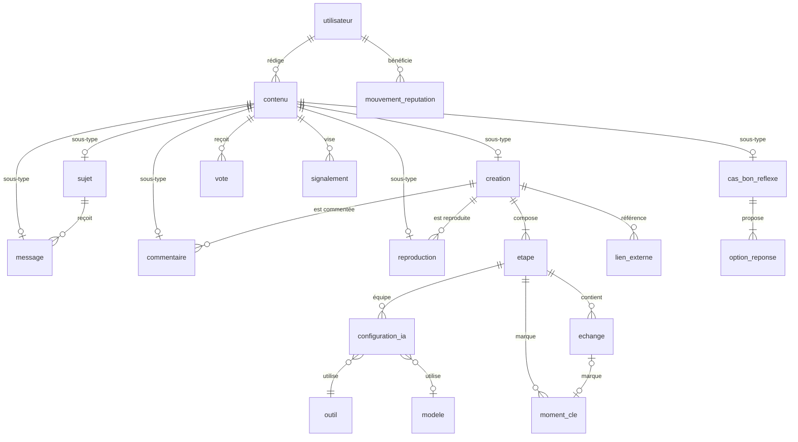

# Modèle logique de données (MLD)

> Passage au relationnel du MCD ([`produit/05-mcd-mvp.md`](produit/05-mcd-mvp.md)), complété par les besoins du prototype et les données techniques.
> **Source de vérité : le schéma Drizzle** (`apps/api/src/db/schema/*.ts`) et les migrations (`apps/api/drizzle/`). Ce document en donne la lecture ; s'ils divergent, le code fait foi et ce document est corrigé.

## 1. Règles de passage

| Sujet | Règle |
|---|---|
| Noms | Tables au singulier, en `snake_case`, au nom de l'entité du MCD (`creation`, `etape`, `moment_cle`). Colonnes sans le suffixe d'entité du MCD (`titre_creation` → `creation.titre`). Côté TypeScript, mêmes noms en camelCase (`dateCreation`) : Drizzle fait la conversion (`casing: 'snake_case'`). |
| Clés primaires | `id bigint generated always as identity`, non signifiant (MCD 2.1). Exceptions : `type_vote.code`, `niveau.rang` (codes stables), tables d'association (clé composée), sous-types de `contenu` (clé héritée). |
| Clés étrangères | `<rôle>_id` : `auteur_id`, `votant_id`, `decideur_id`, `source_id`… Suppression en cascade pour les compositions (étapes d'une création), `set null` pour les références facultatives, restriction ailleurs. |
| Valeurs énumérées | Colonne `text` + contrainte `CHECK (… in (…))` générée depuis `@vysora/shared` (`enums.ts`). Ajouter une valeur = modifier la liste partagée puis générer la migration (plus souple qu'un type `enum` PostgreSQL). |
| Dates | `timestamptz` (UTC) pour les DH du MCD ; `date` pour les D. |
| Textes | `varchar(n)` pour les AN(n) ; `text` pour les T(n) : les longueurs sont contrôlées par les schémas Zod partagés (`LONGUEURS` dans `regles.ts`). |
| Brouillons | Les champs obligatoires « à la publication » acceptent `null` tant que le contenu est en brouillon ; l'API contrôle la complétude au moment de publier (RG-10 à RG-16) et la base vérifie l'essentiel sur la ligne publiée (`creation_publiee_complete_check`). |
| Généralisation | Une table `contenu` (discriminant `type_contenu`) et une table par sous-type dont la clé est aussi clé étrangère **(id, type_contenu)** vers `contenu` : un contenu ne peut appartenir qu'à un seul sous-type (CI-01). |
| Ordres | Unicité `(parent, ordre)` **différée** en fin de transaction (étapes, échanges, options) pour pouvoir réordonner (migration manuelle). |
| Immutabilité | `decision_moderation` refuse toute modification ou suppression (déclencheur, RG-102). |
| Recherche | Configuration plein texte `vysora_fr` (français, sans accents) ; vecteurs dans `recherche_document` (index GIN). |

## 2. Tables par domaine

### Référentiels (F-95)

| Table | Origine | Clés et contraintes notables |
|---|---|---|
| `editeur` | EDITEUR | `nom` unique |
| `outil` | OUTIL (+ extensions) | `nom`, `slug` uniques ; `editeur_id` ; `type` (MCD) et `famille` (prototype) ; `logo`, `logo_monochrome`, `alias[]`, `est_agent` ; `statut` ACTIF/ARCHIVE |
| `modele` | MODELE (+ `nom_court`) | unique `(editeur_id, nom)` ; `statut` DISPONIBLE/RETIRE |
| `outil_modele` | extension | modèles proposés pour un outil (`(outil_id, modele_id)`, ordre) |
| `categorie` | CATEGORIE (+ `slug`, `icone`) | `libelle`, `slug` uniques |
| `licence` | LICENCE (+ `resume`, ordre) | `code` unique ; une seule licence par défaut (index partiel, CI-26) |
| `etiquette` | ETIQUETTE (+ `slug`) | libellé unique sans casse (`lower(libelle)`), `slug` unique |
| `type_vote` | TYPE_VOTE | clé `code` (UTILE, TESTE_OK) |
| `niveau` | NIVEAU (+ privilèges RG-85) | clé `rang` 1 à 5 ; `code`, `seuil_points` uniques ; limites par 24 h (null = sans limite) |
| `badge` | BADGE (+ `ton`) | `code` unique ; `icone` = nom d'icône du sprite |
| `document_legal` | DOCUMENT_LEGAL (+ extensions) | unique `(type, version)` ; `acceptation_requise`, `resume_changements`, `texte` (Markdown) ; `date_annonce` : e-mail envoyé aux membres à la date d'effet (RG-90, WF-03), jamais deux fois ; les versions déjà en vigueur à la migration `0005` sont tenues pour annoncées |

### Comptes, conformité, progression, notifications

| Table | Origine | Clés et contraintes notables |
|---|---|---|
| `utilisateur` | UTILISATEUR (+ `fuseau_horaire`, `refus_mesure_audience`, `nom_affiche`, `date_mot_de_passe`) | pseudo unique sans casse ; `nom_affiche` facultatif (60 caractères, « Claire Dubois »), affiché à la place du pseudo (migration `0004`) ; e-mail unique sans casse (index partiel) et obligatoire sauf compte SUPPRIME ; `role`, `statut_compte`, `langue_interface` contrôlés ; `avatar` : clé de la photo de profil (WebP carré de 256 px au plus) ; `date_mot_de_passe` : dernier changement du mot de passe, nulle s'il date de l'inscription (migration `0006`, PARAM-01) ; `fuseau_horaire` parmi `FUSEAUX_HORAIRES` ; à la suppression (RG-05), pseudo `membre-supprime-xxxx` et données du compte vidées |
| `compte_externe` | COMPTE_EXTERNE (LIER) | unique `(fournisseur, identifiant_fournisseur)` et `(utilisateur_id, fournisseur)` |
| `acceptation_document` | ACCEPTER | clé `(utilisateur_id, document_legal_id)`, date |
| `demande_droit` | DEMANDE_DROIT (DEMANDER) | une demande EN_COURS par membre et par type (index partiel, CI-31) ; `date_expiration_export` : fin du lien de téléchargement (7 jours) ; `fichier_export` reste vide : aucun fichier n'est gardé, il est composé au téléchargement (PARAM-01) |
| `mouvement_reputation` | MOUVEMENT_REPUTATION (CREDITER, ORIGINER, JUSTIFIER) | `beneficiaire_id`, `contenu_id` (origine), `decision_id` (ajustement) ; `acteur_id` et `mouvement_annule_id` (techniques, RG-82) ; CI-24 en base pour la justification |
| `notification` | NOTIFICATION (DESTINER, DECLENCHER, CONCERNER) | `contenu_id` : l'objet de l'événement (le commentaire, l'essai, la réponse du forum, le contenu voté ou masqué, la variante), la création ou le sujet qui le porte se déduit à l'affichage ; `donnees` (JSONB figé : points gagnés, commentaire d'origine, badge, niveau, motif (refus d'un cas, décision), défi et rang, décision (action, fin de suspension, type et intitulé du contenu visé, lisibles après sa suppression), obsolescence ; type `DonneesNotification`) ; `cle_regroupement` unique par destinataire : `VOTES_UTILE_RECUS:<contenu>:<jour UTC>` (votes regroupés, RG-91), `NIVEAU_ATTEINT:<code>` et `BADGE_OBTENU:<code>` (une fois) ; supprimée après 12 mois (politique de confidentialité, EMAIL-01), clé de regroupement comprise ; `email_en_attente` : e-mail encore à décider selon les préférences, remis à faux par la tâche `notifications.emails` avant l'envoi (index partiel, migration `0006`) |
| `obtention_badge` | OBTENIR | clé `(utilisateur_id, badge_id)` (CI-27) |
| `preference_notification` | extension (paramètres du prototype) | clé `(utilisateur_id, evenement)` ; canaux application et e-mail ; sans ligne, la valeur par défaut (e-mail pour les réponses à ses sujets et les réponses acceptées, WF-25) ; écrite par la page Paramètres (PARAM-01) |
| `invitation` | extension (bêta fermée sur invitation) | `code` unique ; créateur, utilisateur, expiration |

### Contenus (généralisation) et interactions communes

| Table | Origine | Clés et contraintes notables |
|---|---|---|
| `contenu` | CONTENU (REDIGER) | discriminant `type_contenu` ; `auteur_id` ; `statut` VISIBLE/MASQUE/SUPPRIME ; `nb_vues` ; unique `(id, type_contenu)` ; `date_masquage_automatique` (F-93) |
| `vote` | VOTER (ternaire) | clé `(votant_id, contenu_id, type_vote_code)` ; index `(contenu_id, type, date)` pour les compteurs et les 7 jours glissants |
| `enregistrement` | ENREGISTRER | clé `(utilisateur_id, contenu_id)` |
| `signalement_obsolescence` | SIGNALER_OBSOLESCENCE (ternaire) | clé `(utilisateur_id, contenu_id, modele_id)` |
| `contenu_etiquette` | ETIQUETER | clé `(contenu_id, etiquette_id)` |
| `media` | MEDIA (ILLUSTRER, JOINDRE, TELEVERSER) | rattachée à un contenu **ou** à un échange, jamais les deux (CI-02), ou à rien juste après l'envoi (supprimée après 24 h si elle le reste) ; `type_mime` et `taille_octets` (5 Mo au plus) décrivent le fichier reçu ; `variantes` : largeur réelle → clé des déclinaisons WebP (720 et 1280, ou la largeur de l'image si elle est plus étroite) ; `fichier` : la plus grande, dont `largeur` et `hauteur` sont les dimensions ; `texte_alternatif` vide permis dans un brouillon, exigé à la publication |

### Créations et parcours

| Table | Origine | Clés et contraintes notables |
|---|---|---|
| `creation` | CREATION (CLASSER, PLACER_SOUS, DERIVER, PARTICIPER) | sous-type de `contenu` ; résultat en texte ou en code au niveau de la création (`resultat_texte`, `resultat_nature` TEXTE ou CODE, `resultat_nom` : nom du fichier ; nature présente si et seulement si texte présent, extension du prototype, migration `0003`) ; `format_resultat` (« Paysage · 4:3 ») et `a_adapter` (liste « À adapter », tableau de textes) repris de la fiche du prototype (migration `0004`) ; `type_creation`, `statut_publication`, `avertissement_agent` ; `slug` ; `categorie_id`, `licence_id`, `source_id` (≠ id), `defi_id` + `rang_final_participation` ; complète si publiée |
| `etape` | ETAPE (COMPOSER) | `creation_id` (cascade) ; unique différé `(creation_id, ordre)` |
| `configuration_ia` | CONFIGURATION_IA (EQUIPER, UTILISER_OUTIL, UTILISER_MODELE) | modèle référencé **ou** texte libre, jamais les deux |
| `echange` | ECHANGE (CONTENIR, REALISER_AVEC) (+ `titre`) | unique différé `(etape_id, ordre)` ; `titre` facultatif (« Composer la réservation ») ; `nb_essais ≥ 1` ; « premier essai » si un seul essai |
| `moment_cle` | MOMENT_CLE (MARQUER_ETAPE, MARQUER_ECHANGE) (+ `titre`) | un échange porte au plus un moment clé (index unique partiel) ; `titre` facultatif (« Vérifier les réservations simultanées »), sinon la fiche titre selon le type |
| `lien_externe` | LIEN_EXTERNE (REFERENCER) | HTTPS uniquement |
| `commentaire` | COMMENTAIRE (COMMENTER, REPONDRE_COMMENTAIRE, ANCRER_*) | sous-type ; un seul ancrage (étape ou échange) ; parent ≠ soi |
| `reproduction` | REPRODUCTION (REPRODUIRE, REPRODUIRE_AVEC_*) | sous-type ; modèle exclusif ; retour ≥ 20 caractères si PARTIEL ou ECHEC (RG-42) |
| `defi` | DEFI (ORGANISER) | durée de 1 à 30 jours (RG-73) ; `slug` |

### Forum et Bon réflexe

| Table | Origine | Clés et contraintes notables |
|---|---|---|
| `sujet` | SUJET (EVOQUER, ACCEPTER_REPONSE, FERMER) | sous-type ; `message_accepte_id` unique, réservé à QUESTION et CLINIQUE ; exemples avant/après obligatoires pour une ASTUCE ; fermeture datée ; outil et modèle facultatifs (`outil_id`, `modele_id` ou `modele_non_reference`, jamais les deux, jamais sans outil) comme dans le prototype (migration `0004`). Le `corps` d’une CLINIQUE porte ses rubriques (RG-62) : le contexte, puis les titres « ### Prompt utilisé » (prompt dans un bloc de code), « ### Résultat obtenu », « ### Résultat attendu » et « ### Outil et modèle », composés et relus par `composerClinique` et `lireClinique` (paquet partagé) |
| `message` | MESSAGE (REPONDRE) | sous-type ; `sujet_id`. Un prompt proposé suit le texte du `corps`, dans un bloc de code « text » final (`composerMessage`, `lireMessage`) |
| `cas_bon_reflexe` | CAS_BON_REFLEXE (EXAMINER) | sous-type ; examen présent si et seulement si le cas est VALIDE ou REFUSE (CI-18), effacé à une nouvelle soumission (RG-71) ; motif obligatoire si REFUSE ; outil et modèle de la réponse étudiée, mêmes règles que pour un sujet (migration `0004`). Seul un cas VALIDE et visible a un document de recherche (RG-31) |
| `option_reponse` | OPTION_REPONSE (PROPOSER) | unique différé `(cas_id, ordre)` ; au plus une option correcte par cas (index partiel, **non différé** : l’API retire la bonne réponse avant de la reposer quand elle change). Options gardées par identifiant à la modification ; figées dès qu’une réponse les désigne (RG-72, contrôlé par l’API) |
| `choix_option` | CHOISIR | clé `(utilisateur_id, cas_id)` : une réponse définitive par cas (RG-72) ; clé étrangère `(option_id, cas_id)` qui garantit que l'option appartient au cas |

### Modération

| Table | Origine | Clés et contraintes notables |
|---|---|---|
| `signalement` | SIGNALEMENT (EMETTRE, VISER, RESOUDRE) | un signalement OUVERT par membre et par contenu (CI-21) ; OUVERT si et seulement si non résolu (CI-20) ; précision obligatoire pour AUTRE |
| `decision_moderation` | DECISION_MODERATION (PRENDRE, PORTER_SUR, SANCTIONNER, JUSTIFIER) | cible obligatoire selon l'action (CI-19) ; suspension de 1 à 90 jours ; `badge_id` pour RETIRER_BADGE ; **immuable**. « Avertir » et « suspendre » prises sur un contenu gardent aussi `contenu_id` : la décision clôt ainsi les signalements du contenu (CI-20). Les annulations de points d’un masquage portent la date de la décision (`mouvement_reputation.date`) : « rétablir » retrouve par elle ce qu’il faut générer de nouveau (RG-82), `decision_id` restant réservé aux ajustements (CI-24) |

### Guides d'Explorer (extension du prototype, DEC-01)

Le prototype présente Explorer comme un index de **guides par objectif**. Le MCD n'en a pas : ces tables sont une extension (migration `0007_guides`). Le contenu d'un guide est rédigé par l'équipe ; ses chiffres (parcours visibles, reproductions, réussite, activité, modèles) se calculent à la lecture.

| Table | Rôle | Clés et contraintes notables |
|---|---|---|
| `guide` | Objectif (« Mettre en place la prise de rendez-vous en ligne »), nom court, domaine, mots-clés, lacunes (« Ce que ce guide ne couvre pas encore ») | `slug` unique (adresse `/explorer?guide=…`) ; `categorie_id` (domaine) ; `date_publication` null tant que le guide est en préparation |
| `guide_contenu` | Parcours (créations), questions (sujets) et cas Bon réflexe du guide, dans son ordre | clé `(guide_id, contenu_id)` ; cascade depuis le guide et le contenu ; seuls les contenus publiés et visibles sont présentés (RG-30) ; une création publiée y est ajoutée par rapprochement (`rattachement.ts`) |
| `guide_etape` | « La méthode qui ressort » : titre, conseil, prompt cité | unique `(guide_id, ordre)` ; `citation_creation_id` (`set null`) et `citation_texte` : pas de création citée sans texte |
| `guide_etape_source` | Parcours qui suivent une étape | clé `(etape_id, creation_id)`, cascades |
| `guide_piege` | « Les pièges à anticiper » : titre, ce qui a fonctionné, étape, discussion, cas | unique `(guide_id, ordre)` ; `etape_id`, `sujet_id`, `cas_id` en `set null` |
| `guide_piege_source` | Parcours où le piège a été rencontré | clé `(piege_id, creation_id)`, cascades |
| `demande_guide` | « Ce que la communauté cherche encore » | `libelle` unique ; `date_cloture` quand un guide couvre l'objectif |
| `soutien_demande` | « Je le cherche aussi » | clé `(demande_id, utilisateur_id)` ; compté sur 30 jours, date renouvelée à chaque clic |
| `proposition_piege` | « Signaler un piège » : relu par l'équipe | `statut` EN_RELECTURE/RETENUE/ECARTEE ; `date_relecture` présente si et seulement si relu ; `etape_id` en `set null` |
| `liste_controle` | « Ma liste de contrôle » d'un membre | clé `(utilisateur_id, guide_id)` ; étapes et pièges cochés (`bigint[]`, réduits à la lecture à ceux qui existent encore) |

Les tables d'un membre (`soutien_demande`, `proposition_piege`, `liste_controle`) figurent dans l'export F-07 et sont effacées à la suppression du compte (F-08).

### Données techniques (hors MCD)

| Table | Rôle |
|---|---|
| `session` | Session ouverte sur un appareil ; identifiant = empreinte SHA-256 du jeton du cookie ; appareil, lieu approximatif, empreinte d'IP, double authentification validée. Supprimée chaque jour une fois expirée (EMAIL-01). |
| `jeton` | Liens à usage unique envoyés par e-mail (vérification, réinitialisation, changement d'e-mail, confirmation de suppression) ; seule l'empreinte est stockée. |
| `double_authentification` | Secret TOTP chiffré, codes de secours hachés (ENF-05) ; `date_activation` nulle tant que le premier code n'est pas confirmé ; `dernier_pas` : dernier pas de 30 secondes accepté, un code déjà servi est refusé (migration `0009`, SEC-02). |
| `tentative_connexion` | Échecs et réussites, pour temporiser après 5 échecs consécutifs (F-03). Désignées par l'empreinte salée de l'adresse saisie (`empreinte_identifiant`), qu'elle corresponde à un compte ou non : la temporisation ne révèle pas les comptes existants (migration `0002`). Conservées un an (politique de confidentialité), puis supprimées (EMAIL-01). |
| `journal_audit` | Changements de rôle et actions d'administration (ENF-09). |
| `vue_contenu` | Une vue par visiteur et par jour (F-23) ; empreinte salée du jour (membre, ou adresse IP et navigateur), effacée après 2 jours par `conservation.appliquer` (INT-04). |
| `recherche_document` | Index plein texte des contenus publiés (RG-31) : créations publiées, sujets visibles, cas validés. La recherche des parcours d'Explorer écarte les mots vides et ajoute les synonymes du prototype (`@vysora/shared`, `recherche.ts`). |
| `message_contact` | Messages de la page Contact, y compris les signalements sans compte. |
| schéma `pgboss` | File des tâches différées (EMAIL-01), créé et mis à jour par pg-boss au démarrage de l'API, hors des migrations Drizzle : files, tâches (les e-mails y attendent chiffrés), planifications. |

## 3. Contraintes d'intégrité : où elles vivent

| Contraintes | En base | Dans l'API |
|---|---|---|
| CI-01 (partition des contenus) | Exclusion par la clé `(id, type_contenu)` | Totalité : créer `contenu` et son sous-type dans la même transaction |
| CI-02, CI-09 (exclusivité modèle), CI-11 (un ancrage), CI-14 (source ≠ soi), CI-16 (une option correcte), CI-18, CI-19, CI-20, CI-21, CI-23, CI-24 (justification), CI-26, CI-27, CI-31 | Oui (CHECK, index uniques partiels, clés) | Messages d'erreur clairs avant d'atteindre la base |
| CI-03 à CI-08, CI-10, CI-12, CI-13, CI-15, CI-17, CI-22, CI-25, CI-28 à CI-30, nombres de 2 à 5 options, limites d'images et de liens | — | Oui, avec un test par règle |

## 4. Données calculées

Réputation (somme des mouvements, plancher à 0), niveau, compteurs de votes, indicateurs de preuve, popularité sur 7 jours, classements, statistiques du profil, suspension en cours, état d'un sujet : **calculés par requête**, comme le prévoit le MCD (section 8). Index prévus pour ces calculs (`vote`, `mouvement_reputation`, `reproduction`). Si une page devient lente, on ajoute un cache dénormalisé mis à jour dans la même transaction (par exemple une table `contenu_compteur`), documenté ici.

## 5. Vue d'ensemble du cœur

## 6. Faire évoluer le schéma

1. Modifier le schéma TypeScript (`apps/api/src/db/schema/<domaine>.ts`) ; pour une nouvelle valeur énumérée, modifier d'abord `packages/shared/src/enums.ts`.
2. `pnpm --filter @vysora/shared build` puis `pnpm db:generate` : relire le SQL produit dans `apps/api/drizzle/`.
3. Ce que Drizzle ne sait pas décrire (contrainte différée, déclencheur, fonction, configuration de recherche) : `pnpm --filter @vysora/api exec drizzle-kit generate --custom --name <nom>`, puis écrire le SQL.
4. `pnpm db:migrate`, puis `pnpm test:e2e` (la base de test est recréée depuis les migrations).
5. Mettre à jour ce document si la lecture change (nouvelle table, nouvelle règle en base).

Une migration publiée n'est jamais modifiée : on en ajoute une nouvelle. En développement, `pnpm db:reset` repart de zéro.
