# Vysora — Parcours utilisateurs et workflows du MVP

| Élément | Valeur |
|---|---|
| Projet | Vysora |
| Document | 04 — Parcours utilisateurs et workflows MVP |
| Version | 1.0 |
| Date | 11/10/2026 |
| Statut | Version de travail soumise à validation du porteur de projet |
| Classification | Confidentiel — diffusion restreinte à l'équipe projet |

---

## Sommaire

1. [Conventions](#1-conventions)
2. [Plan de navigation](#2-plan-de-navigation)
3. [Parcours utilisateurs](#3-parcours-utilisateurs)
4. [Workflows détaillés](#4-workflows-détaillés)
5. [Cycles de vie](#5-cycles-de-vie)
6. [Matrice de couverture](#6-matrice-de-couverture)

---

## 1. Conventions

- **Parcours utilisateur (PU-xx)** : enchaînement de bout en bout vécu par un persona (document 02), avec ses écrans, ses fonctionnalités et ses points de friction.
- **Workflow (WF-xx)** : déroulement détaillé d'une tâche : acteurs, déclencheur, préconditions, scénario nominal, variantes, exceptions, résultat.
- **Cycle de vie (CV-xx)** : états successifs d'un objet métier. Les noms d'états sont ceux des valeurs définies dans le MCD (document 05).
- **Écran (EC-xx)** : écran ou page de l'application (section 2).
- Les diagrammes sont rédigés en Mermaid. Ils s'affichent dans GitHub, GitLab, Notion, Obsidian et la plupart des éditeurs Markdown.
- Les références F-, RG-, O-, D- renvoient aux documents 01 et 03.

---

## 2. Plan de navigation

### 2.1 Liste des écrans

| ID | Écran | Accès | Fonctionnalités |
|---|---|---|---|
| EC-01 | Accueil | Tous | F-21 |
| EC-02 | Explorer (recherche et résultats) | Tous | F-22 |
| EC-03 | Page catégorie ou étiquette | Tous | F-25 |
| EC-04 | Fiche création | Tous | F-23, F-24, F-26, F-30, F-32 à F-35, F-40 à F-42 |
| EC-05 | Éditeur de création | Membre | F-10 à F-20, F-64 |
| EC-06 | Forum (liste des sujets) | Tous | F-50 |
| EC-07 | Sujet | Tous | F-51 à F-55, F-30, F-31, F-35 |
| EC-08 | Éditeur de sujet | Membre | F-50, F-53, F-54 |
| EC-09 | Bon réflexe (liste des cas) | Tous | F-62 |
| EC-10 | Cas Bon réflexe | Tous | F-62, F-30 |
| EC-11 | Éditeur de cas | Membre de niveau Expert ou plus, modérateur | F-60 |
| EC-12 | Défis (liste et détail) | Tous | F-63 à F-65 |
| EC-13 | Classements | Tous | F-75 |
| EC-14 | Profil public | Tous | F-05, F-73, F-74 |
| EC-15 | Mes contenus (brouillons, publiés, enregistrés) | Membre | F-16, F-34 |
| EC-16 | Notifications | Membre | F-81 |
| EC-17 | Paramètres et mes données | Membre | F-06, F-07, F-08, F-02 |
| EC-18 | Inscription, connexion, mot de passe oublié | Visiteur | F-01 à F-04 |
| EC-19 | File de modération | Modérateur | F-91, F-93 |
| EC-20 | Cas à valider | Modérateur | F-61 |
| EC-21 | Journal des décisions | Administrateur | F-92 |
| EC-22 | Référentiels | Administrateur | F-95 |
| EC-23 | Rôles | Administrateur | F-96 |
| EC-24 | Gestion des défis | Administrateur | F-63, F-65 |
| EC-25 | Documents légaux | Administrateur | F-04, F-95 |
| EC-26 | Tableau de bord des indicateurs | Administrateur | F-97 |

### 2.2 Arborescence

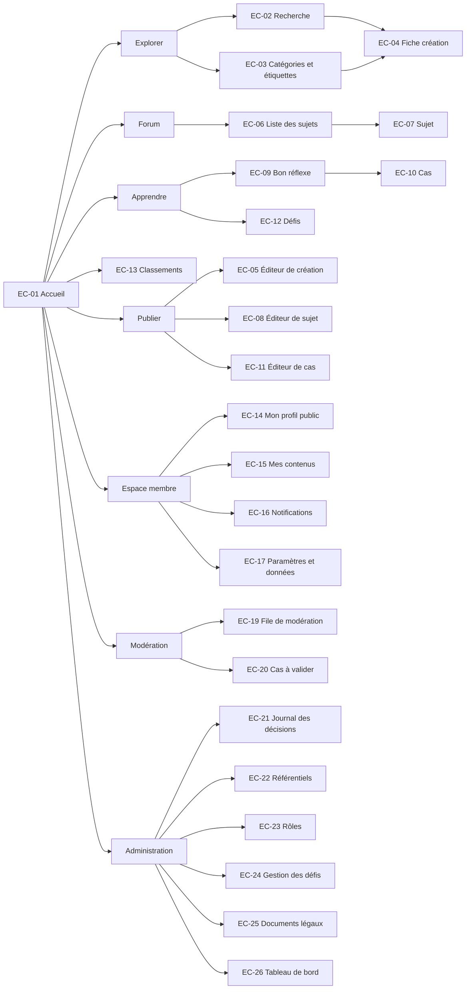

Les entrées « Modération » et « Administration » ne sont affichées qu'aux rôles concernés. EC-18 est accessible depuis toutes les pages pour un visiteur.

---

## 3. Parcours utilisateurs

### PU-01 — Inès, débutante : de la découverte à l'entraide

**Objectif d'Inès :** sécuriser le formulaire de réservation de son site créé avec l'IA.

| # | Étape | Action | Écran | Fonctionnalités | Ressenti et risque d'abandon | Parade |
|---|---|---|---|---|---|---|
| 1 | Découvrir | Arrive depuis un moteur de recherche sur une création « Formulaire de réservation sécurisé » | EC-04 | F-23 | Curieuse ; risque de partir si la fiche est trop technique | Résultat et moments clés en tête de fiche ; parcours replié |
| 2 | Essayer sans compte | Répond à un cas Bon réflexe proposé en bas de fiche | EC-10 | F-62 | Surprise de s'être trompée ; envie d'en savoir plus | Explication claire ; invitation à s'inscrire pour suivre ses progrès |
| 3 | S'inscrire | Crée un compte, vérifie son e-mail, accepte les documents | EC-18 | F-01, F-04 | Friction de l'inscription | Formulaire court ; connexion GitHub ou Google (F-02) |
| 4 | Garder | Enregistre la création | EC-04 | F-34 | Rassurée de la retrouver | Liste « Enregistrés » accessible depuis le menu |
| 5 | Reproduire | Copie le prompt, l'essaie dans son outil, déclare un résultat partiel | EC-04 | F-24, F-32 | Frustrée par le résultat partiel | Retour obligatoire qui l'aide à formuler ce qui diffère |
| 6 | Demander de l'aide | Ouvre une Clinique du prompt liée à la création | EC-08, EC-07 | F-50, F-54 | Inquiète d'être jugée | Rubriques guidées ; charte ; pas de vote négatif |
| 7 | Recevoir de l'aide | Reçoit deux réponses, relance avec la proposition de Claire, puis l'accepte | EC-07, EC-16 | F-51, F-52, F-81 | Soulagée | Notification immédiate de chaque réponse |
| 8 | Progresser | Gagne ses premiers points et le badge « Premier essai » | EC-14 | F-70, F-74 | Fière | Progression visible sur son profil |
| 9 | Revenir | Revient pour le cas Bon réflexe du jour et le défi de la semaine | EC-01, EC-10, EC-12 | F-21, F-62, F-64 | Engagée | Accueil personnalisé pour les membres |

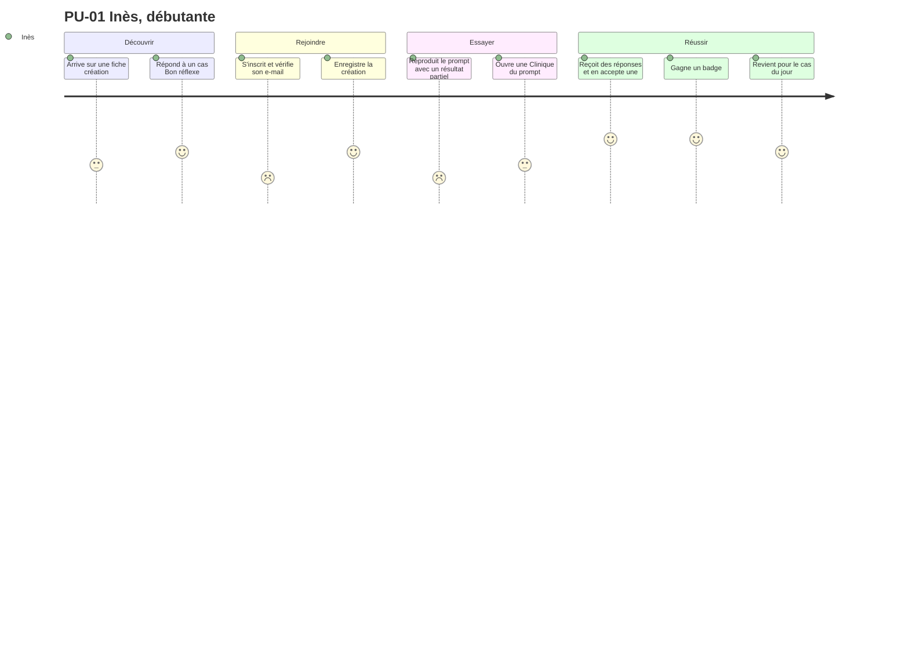

### PU-02 — Yacine, praticien : trouver ce qui marche encore, puis partager

| # | Étape | Action | Écran | Fonctionnalités | Ressenti et risque d'abandon | Parade |
|---|---|---|---|---|---|---|
| 1 | Chercher | Recherche « tests unitaires » filtrée par son outil et le dernier modèle | EC-02 | F-22 | Pressé ; part si les résultats sont hors sujet | Filtres outil, modèle, « reproduite avec succès » |
| 2 | Évaluer | Compare taux de reproduction, date et signalements d'obsolescence | EC-04 | F-33 | Méfiant | Indicateurs de preuve et de fraîcheur visibles sans défiler |
| 3 | Utiliser | Copie le prompt et l'utilise dans son travail | EC-04 | F-24 | Satisfait | Copie en un clic |
| 4 | Confirmer | Déclare une reproduction réussie | EC-04 | F-32 | Neutre | Formulaire court, prérempli avec son dernier outil utilisé |
| 5 | Alerter | Signale qu'une autre astuce ne fonctionne plus avec le nouveau modèle | EC-07 | F-35 | Utile à la communauté | Signalement en deux clics |
| 6 | Partager | Publie sa propre astuce avec exemple avant/après | EC-08 | F-50, F-53 | Envie de reconnaissance | Exemple avant/après mis en valeur |
| 7 | Être reconnu | Reçoit des votes « Testé, ça marche » | EC-07, EC-16 | F-31, F-70, F-81 | Motivé | Compteur « Testée par N membres » et points |

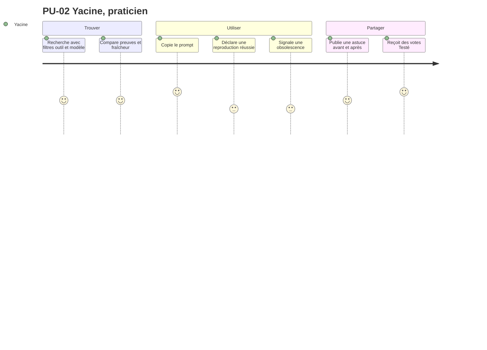

### PU-03 — Claire, experte : publier un projet complet et être reconnue

| # | Étape | Action | Écran | Fonctionnalités | Ressenti et risque d'abandon | Parade |
|---|---|---|---|---|---|---|
| 1 | Être invitée | Reçoit une invitation à la bêta fermée et s'inscrit avec GitHub | EC-18 | F-01, F-02, F-04 | Intriguée | Badge « Pionnier » ; accompagnement à la première publication |
| 2 | Créer le brouillon | Choisit « Projet », renseigne titre, objectif, catégorie, licence | EC-05 | F-12, F-16, F-17 | Craint que ce soit long | Enregistrement automatique du brouillon |
| 3 | Décrire le parcours | Ajoute 5 étapes avec récit, configurations IA et prompts clés | EC-05 | F-12, F-13 | Risque d'abandon le plus élevé (H-05) | Étapes réordonnables ; échanges facultatifs ; mesure du taux d'abandon |
| 4 | Valoriser sa méthode | Marque 3 moments clés (2 refus, 1 vérification) | EC-05 | F-14 | Valorisée | Moments clés mis en avant sur la fiche |
| 5 | Montrer le résultat | Ajoute captures, lien de démo et lien du dépôt | EC-05 | F-15 | Neutre | Limites affichées avant l'envoi des fichiers |
| 6 | Publier | Reçoit une alerte sur une clé d'API oubliée, la retire, puis publie | EC-05 | F-18, F-16 | Reconnaissante d'avoir été prévenue | Passages détectés listés précisément |
| 7 | Diffuser | Partage le lien sur LinkedIn | EC-04 | F-26 | Fière | Aperçu de partage soigné |
| 8 | Échanger | Reçoit des commentaires ancrés et une variante ; répond | EC-04, EC-16 | F-40, F-41, F-20, F-81 | Engagée | Notifications ; crédit de la variante |
| 9 | Aider | Répond à des cliniques ; deux réponses sont acceptées | EC-07 | F-51, F-52 | Utile | Points et badge « Premier coup de main » |
| 10 | Transmettre | Atteint le niveau Expert et propose un cas Bon réflexe | EC-11 | F-71, F-60 | Reconnue | Le droit de proposer des cas marque son statut |

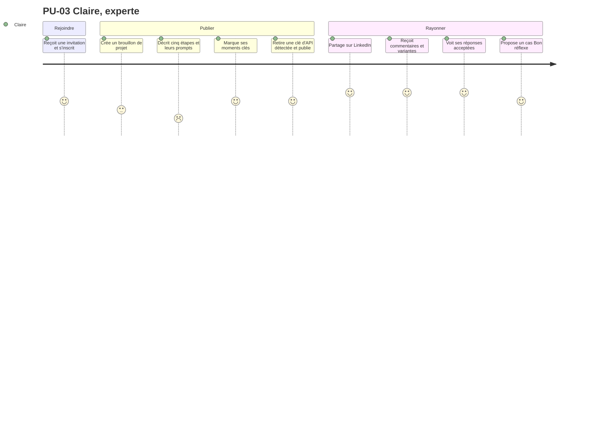

### PU-04 — Thomas, modérateur : traiter un signalement

| # | Étape | Action | Écran | Fonctionnalités |
|---|---|---|---|---|
| 1 | Consulter | Ouvre la file de modération ; un contenu masqué automatiquement est en tête | EC-19 | F-91, F-93 |
| 2 | Examiner | Lit le contenu, les motifs de signalement et l'historique de l'auteur | EC-19 | F-91 |
| 3 | Décider | Constate une clé d'API exposée : masque le contenu avec le motif « données personnelles ou secrets » | EC-19 | F-91 |
| 4 | Informer | L'auteur reçoit une notification et un e-mail avec l'action et le motif | — | F-92, F-80 |
| 5 | Rétablir | Après correction par l'auteur, Thomas rétablit le contenu | EC-19 | F-91 |
| 6 | Valider des cas | Valide un cas Bon réflexe et en refuse un autre avec motif | EC-20 | F-61 |

### PU-05 — L'administrateur : maintenir la plateforme

| # | Étape | Action | Écran | Fonctionnalités |
|---|---|---|---|---|
| 1 | Référentiel | Ajoute un nouveau modèle et retire un modèle obsolète | EC-22 | F-95 |
| 2 | Défi | Crée puis publie le défi de la semaine | EC-24 | F-63 |
| 3 | Clôture | Clôture le défi précédent ; le classement est publié | EC-24 | F-65 |
| 4 | Rôles | Nomme un nouveau modérateur | EC-23 | F-96 |
| 5 | Légal | Publie une nouvelle version des CGU avec sa date d'effet | EC-25 | F-04, F-95 |
| 6 | Pilotage | Consulte la North Star et les indicateurs O-01 à O-08 | EC-26 | F-97 |

---

## 4. Workflows détaillés

### WF-01 — Inscription et vérification de l'e-mail

| Rubrique | Contenu |
|---|---|
| Acteurs | Visiteur, système |
| Déclencheur | Le visiteur clique sur « S'inscrire » |
| Préconditions | Aucune |
| Fonctionnalités, règles | F-01, F-02, F-04 · RG-01 à RG-04 |

**Scénario nominal**
1. Le visiteur choisit « Inscription par e-mail ».
2. Il saisit pseudo, e-mail et mot de passe, puis accepte les CGU, la politique de confidentialité et la charte en vigueur.
3. Le système contrôle l'unicité du pseudo et de l'e-mail, et la politique de mot de passe.
4. Le système crée le compte (statut ACTIF, e-mail non vérifié, rôle MEMBRE), enregistre les acceptations et envoie l'e-mail de vérification.
5. Le visiteur clique sur le lien ; l'e-mail est vérifié et le compte peut contribuer.

**Variantes**
- 1a. Le visiteur choisit GitHub ou Google : après autorisation, il choisit un pseudo et accepte les documents ; l'e-mail fourni par le service est considéré comme vérifié ; le compte externe est lié. Fin.

**Exceptions**
- 3a. Pseudo ou e-mail déjà utilisé : message sur le champ concerné ; retour à l'étape 2.
- 5a. Lien expiré (plus de 24 h) : proposition d'un nouveau lien.
- 1a-a. L'e-mail du service correspond à un compte existant : aucun compte n'est créé ; invitation à se connecter puis à lier le service depuis EC-17.

**Résultat :** compte actif ; e-mail vérifié ; documents légaux acceptés et datés. Le membre est invité à compléter son profil public : avatar, biographie, lien personnel (F-05).

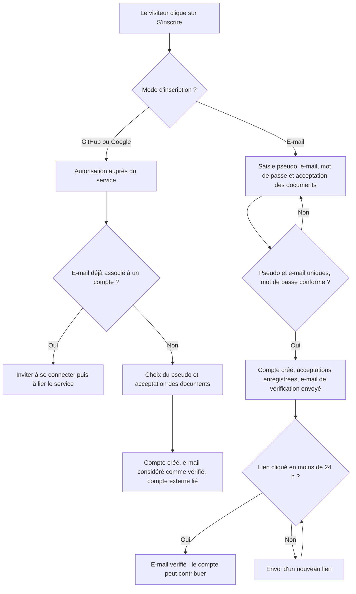

### WF-02 — Connexion et réinitialisation du mot de passe

| Rubrique | Contenu |
|---|---|
| Acteurs | Membre, système |
| Fonctionnalités | F-03, F-80 |

**Scénario nominal :** le membre saisit ses identifiants ; le système les vérifie et ouvre la session ; la date de dernière connexion est mise à jour.

**Variantes**
- Mot de passe oublié : le membre saisit son e-mail ; le système affiche toujours le même message de confirmation ; si l'e-mail existe, un lien valable 1 h est envoyé ; le membre définit un nouveau mot de passe.
- Compte EN_SUPPRESSION : la connexion annule la demande de suppression (WF-23).
- Nouvelle version d'un document légal en vigueur : redirection vers WF-03.
- Modification des paramètres (EC-17, F-06) : un changement d'e-mail exige la vérification de la nouvelle adresse et déclenche une alerte à l'ancienne ; un changement de mot de passe exige le mot de passe actuel.

**Exceptions :** après 5 échecs consécutifs, les tentatives suivantes sont temporisées ; un compte BANNI ne peut pas se connecter ; un compte suspendu se connecte en lecture seule (RG-103).

### WF-03 — Acceptation d'une nouvelle version d'un document légal

1. Un administrateur publie une nouvelle version d'un document avec sa date d'effet (EC-25).
2. À la date d'effet, un e-mail informe tous les membres actifs (RG-90).
3. À sa connexion suivante, le membre voit le document et l'accepte.
4. Tant qu'il ne l'a pas accepté, son compte reste en lecture seule (F-04).

### WF-04 — Publier une création « 1 prompt »

| Rubrique | Contenu |
|---|---|
| Acteur | Membre vérifié, non suspendu |
| Déclencheur | « Nouvelle création » puis « 1 prompt » |
| Fonctionnalités, règles | F-10, F-13, F-15 à F-19 · RG-10, RG-11, RG-14, RG-16, RG-17, RG-20, RG-22, RG-23, RG-85 |

**Scénario nominal**
1. Le système crée un brouillon avec une étape et un échange vides ; la licence par défaut est proposée.
2. Le membre renseigne titre, objectif, catégorie, étiquettes et la configuration IA (outil, modèle, paramètres, contexte caché).
3. Il colle le prompt et la réponse, joint d'éventuelles images, indique le nombre d'essais et le mode de sélection.
4. Il ajoute ses limites constatées et ses liens externes, dont éventuellement un lien de preuve.
5. Il clique sur « Publier ».
6. Le système contrôle les règles de complétude (RG-10, RG-11, RG-14, RG-16) et la limite quotidienne (RG-85).
7. Le système recherche les données sensibles (RG-22) ; aucune n'est détectée.
8. Le membre coche la confirmation « aucune donnée personnelle de tiers ni aucun secret » et confirme.
9. Le système passe la création à PUBLIEE, enregistre la date de publication et attribue le badge « Première création » s'il s'agit de la première.

**Variantes**
- 5a. Le membre clique sur « Enregistrer le brouillon » : la création reste en BROUILLON, visible de lui seul. Fin.
- 7a. Données sensibles détectées : le système liste les passages ; le membre corrige (retour à l'étape 2) ou confirme explicitement la publication.
- 2a. Le modèle n'existe pas dans le référentiel : le membre le saisit en texte libre.
- 2b. Le prompt contient des instructions pour un agent : le membre coche l'avertissement « instructions pour agent ».

**Exceptions**
- 6a. Champ manquant ou invalide : la publication est refusée ; chaque champ est signalé ; le brouillon est conservé.
- 6b. Limite quotidienne atteinte : refus avec l'heure de la prochaine publication possible ; le brouillon est conservé.

**Résultat :** création PUBLIEE, visible de tous, indexable, ouverte aux votes, reproductions et commentaires.

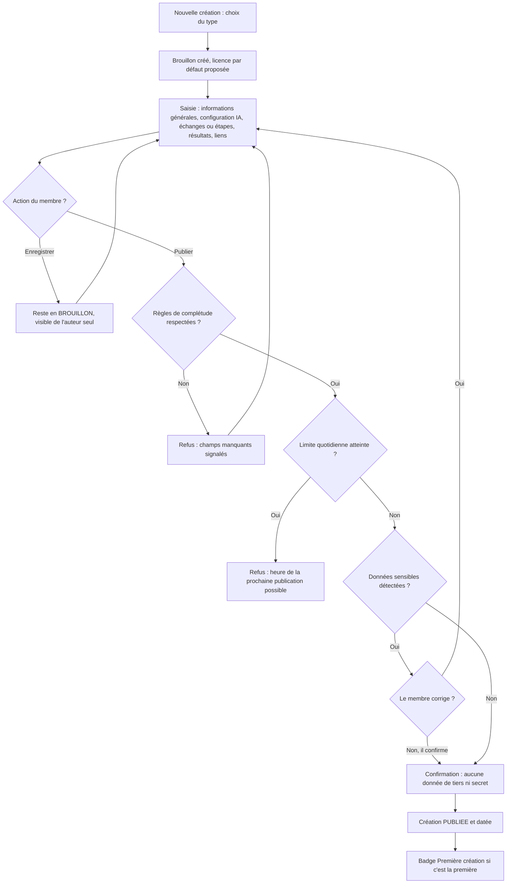

Ce diagramme vaut pour les trois types de création. Les règles de complétude dépendent du type : RG-11 pour « 1 prompt », RG-12 pour « Itération », RG-13 pour « Projet ».

### WF-05 — Publier une création « Itération »

Identique à WF-04, sauf aux étapes 1 et 3 :
1. Le brouillon est créé avec une étape et aucun échange.
3. Le membre ajoute au moins deux échanges, les ordonne, joint des images et marque éventuellement des moments clés (type et explication) sur les échanges décisifs.

**Exception spécifique :** moins de deux échanges, ou dernier échange sans réponse ni image : publication refusée (RG-12).

### WF-06 — Publier une création « Projet »

Identique à WF-04, sauf aux étapes 1 à 4 :
1. Le brouillon est créé sans étape.
2. Le membre renseigne les informations générales.
3. Pour chaque étape, dans l'ordre : titre et récit ; zéro, une ou plusieurs configurations IA ; zéro, un ou plusieurs échanges clés, chacun rattaché à sa configuration si l'étape en a plusieurs ; moments clés sur l'étape ou sur un échange.
4. Le membre ajoute au moins un résultat final : lien externe (démo, dépôt, vidéo) ou image jointe à la création.

**Exceptions spécifiques :** moins de deux étapes, étape sans titre ou avec un récit trop court, échanges sans configuration, ou absence de résultat final : publication refusée (RG-13, RG-14).

**Point de mesure :** le taux d'abandon des brouillons de projet est suivi pour valider H-05 (document 01).

### WF-07 — Modifier, dépublier ou supprimer une création

| Action | Acteur | Effet |
|---|---|---|
| Modifier | Auteur | Les champs sont modifiables, sauf le type (RG-18) ; la date de modification est affichée ; les règles de complétude sont revérifiées. |
| Dépublier | Auteur | Retour en BROUILLON ; la création et ses commentaires et reproductions ne sont plus visibles jusqu'à republication (RG-17). |
| Supprimer | Auteur | Le contenu passe au statut SUPPRIME ; commentaires et reproductions disparaissent ; les variantes affichent « Création source supprimée » ; les points liés sont annulés (RG-19, RG-82). |

La suppression demande une confirmation explicite ; elle est irréversible pour l'auteur.

### WF-08 — Proposer une variante

1. Sur une création publiée d'un autre membre, sous une licence qui autorise les variantes, le membre clique sur « Proposer une variante ».
2. Le système crée un brouillon prérempli (type, catégorie, configurations) lié à la création source.
3. Le membre modifie et publie selon WF-04, WF-05 ou WF-06.
4. À la publication, la variante affiche « Variante de… », la source liste ses variantes et son auteur est notifié.

**Exception :** licence « Tous droits réservés » ou création de l'auteur lui-même : le bouton n'est pas proposé (RG-21).

### WF-09 — Rechercher et consulter

1. L'utilisateur part de l'accueil (EC-01, F-21), saisit des mots-clés (EC-02) ou entre par une catégorie ou une étiquette (EC-03).
2. Il applique des filtres (type, catégorie, outil, éditeur, modèle, étiquette, période, avec moments clés, reproduite avec succès) et un tri.
3. Il ouvre une fiche création (EC-04) ; le compteur de vues augmente au plus une fois par visiteur et par jour.
4. Il lit le résultat, le résumé des moments clés, puis déplie le parcours et copie un prompt (F-24).

**Règle de visibilité :** RG-30.

### WF-10 — Déclarer une reproduction

| Rubrique | Contenu |
|---|---|
| Acteur | Membre vérifié, non auteur de la création |
| Préconditions | Création PUBLIEE de type « 1 prompt » ou « Itération » |
| Fonctionnalités, règles | F-32, F-33 · RG-42, RG-43, RG-80 |

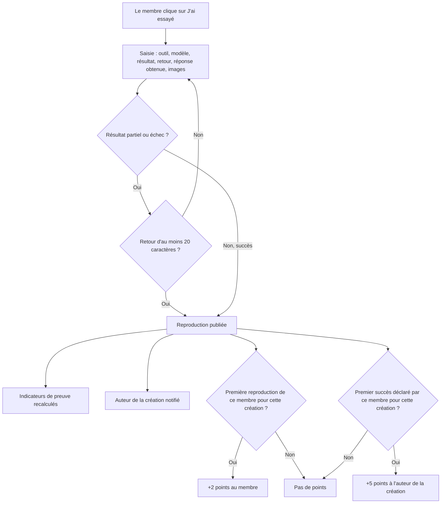

### WF-11 — Voter et enregistrer

1. Le membre clique sur « Utile » ou « Testé, ça marche ».
2. Le système vérifie : membre vérifié, non auteur, type de vote autorisé pour ce contenu (RG-40, RG-41), vote non encore émis.
3. Le vote est enregistré et daté ; un mouvement de réputation est créé pour l'auteur dans la limite du plafond quotidien (RG-80, RG-81) ; l'auteur reçoit une notification regroupée (RG-91).
4. Un second clic annule le vote et génère le mouvement inverse (RG-82).

**Enregistrer :** un clic ajoute le contenu à la liste privée du membre ; un second clic le retire (RG-45).

### WF-12 — Signaler une obsolescence

1. Sur une création publiée ou une astuce dont il n'est pas l'auteur, le membre choisit « Ne fonctionne plus avec… ».
2. Il sélectionne un modèle et ajoute une remarque facultative.
3. Le système refuse un doublon (même membre, même contenu, même modèle).
4. Au 3e signalement distinct pour le même modèle, la bannière s'affiche et l'auteur est notifié (RG-44).

### WF-13 — Commenter

1. Sur une création publiée, le membre écrit un commentaire, éventuellement ancré à une étape ou à un échange (« Commenter ce passage »).
2. Le système publie le commentaire et notifie l'auteur de la création.
3. Un autre membre répond au commentaire ; l'auteur du commentaire est notifié. Une réponse à une réponse est rattachée au commentaire d'origine (RG-50).
4. L'auteur d'un commentaire peut le modifier ou le supprimer (RG-51).

### WF-14 — Poser une question ou une clinique, puis accepter une réponse

| Rubrique | Contenu |
|---|---|
| Acteurs | Auteur du sujet, membres qui répondent, système |
| Fonctionnalités, règles | F-50, F-51, F-52, F-54 · RG-60, RG-62, RG-63, RG-64, RG-66, RG-80 |

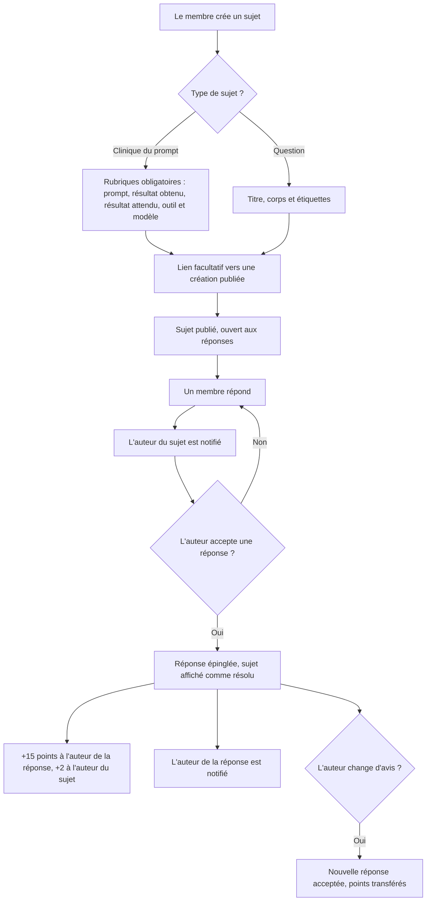

**Exception :** l'auteur ne peut pas accepter sa propre réponse ; un sujet fermé ne reçoit plus de réponses.

### WF-15 — Publier une astuce

1. Le membre crée un sujet de type Astuce.
2. Il rédige titre, corps, exemple « avant » et exemple « après » (RG-61), choisit de 1 à 5 étiquettes et joint jusqu'à 5 images.
3. L'astuce est publiée et peut recevoir les votes « Utile » et « Testé, ça marche » (WF-11) et des signalements d'obsolescence (WF-12).

### WF-16 — Fermer ou rouvrir un sujet

1. L'auteur du sujet ou un modérateur clique sur « Fermer » ; la date et l'auteur de la fermeture sont enregistrés.
2. Le sujet reste lisible ; il n'accepte plus de réponses.
3. Réouverture : par l'auteur s'il a lui-même fermé le sujet ; par un modérateur dans tous les cas (RG-65).

### WF-17 — Proposer et valider un cas Bon réflexe

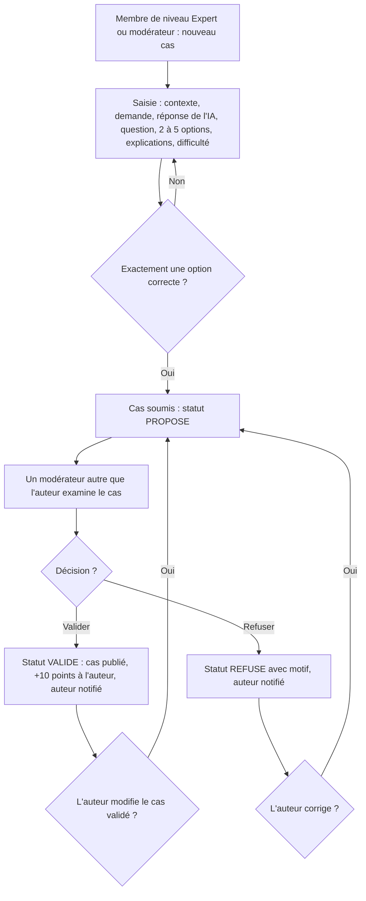

### WF-18 — Répondre à un cas Bon réflexe

1. Le membre ouvre un cas validé (EC-10) et lit le contexte, la demande et la réponse de l'IA.
2. Il choisit une option.
3. Le système enregistre ce choix, définitif (RG-72), et affiche la bonne option, l'explication de chaque option, l'explication générale et la répartition des réponses de la communauté.
4. Si la réponse est correcte : +1 point ; vérification des badges « Bon réflexe » et « Assidu ».

**Variantes**
- Visiteur : il peut répondre, mais sa réponse n'est pas enregistrée ; il est invité à s'inscrire.
- Cas déjà répondu : le membre voit sa réponse d'origine.
- Auteur du cas : il ne peut pas répondre.

### WF-19 — Organiser un défi

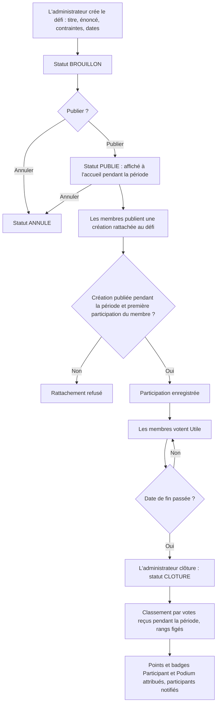

### WF-20 — Attribution de la réputation, des niveaux et des badges

Processus automatique, déclenché par chaque événement du barème (RG-80).

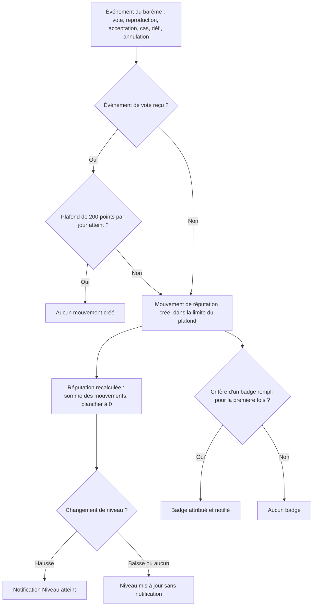

À chaque mouvement, les statistiques du profil (RG-88) et les classements (RG-87) sont recalculés à partir des mouvements de réputation et des contenus.

### WF-21 — Signalement et modération

| Rubrique | Contenu |
|---|---|
| Acteurs | Membre, modérateur, administrateur, système |
| Fonctionnalités, règles | F-90 à F-93 · RG-100 à RG-105 |

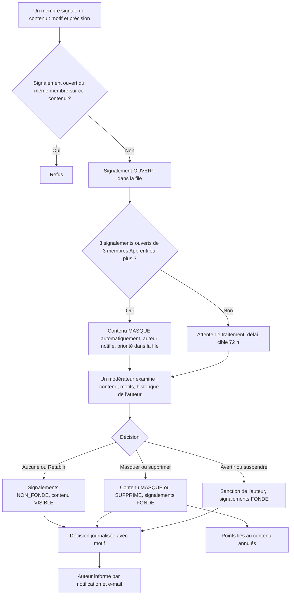

**Règles complémentaires :** un modérateur ne statue ni sur ses propres contenus ni sur son propre compte (RG-104) ; le bannissement, l'ajustement de réputation et le retrait de badge sont réservés aux administrateurs (RG-102).

### WF-22 — Exporter ses données

1. Le membre demande un export depuis EC-17.
2. Le système enregistre la demande (EN_COURS).
3. Le fichier est produit dans un délai maximal d'un mois (RG-06) ; le membre reçoit un e-mail avec un lien valable 7 jours.
4. La demande passe à TRAITEE.

### WF-23 — Supprimer son compte

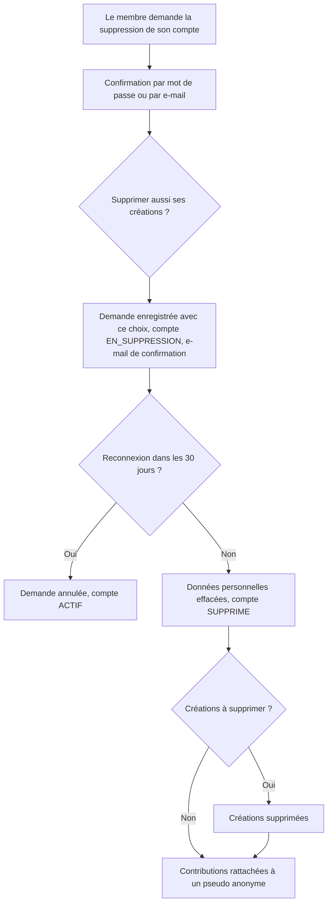

À l'étape J, les contributions conservées sont les créations (si le membre n'a pas demandé leur suppression) et ses autres contributions (sujets, réponses, commentaires, reproductions, cas), toujours anonymisées (D-09, RG-05).

### WF-24 — Gérer les référentiels et les rôles

1. L'administrateur ajoute ou modifie un élément de référentiel (EC-22).
2. Pour retirer un élément déjà utilisé, il l'archive : l'élément reste affiché sur les contenus existants mais n'est plus proposé (RG-110).
3. Pour les rôles (EC-23), il attribue ou retire Modérateur ou Administrateur ; le système refuse le retrait du dernier administrateur actif (RG-111) ; chaque changement est journalisé (ENF-09).

### WF-25 — Notifier un événement

1. Un événement de la liste RG-91 ou RG-90 survient.
2. Le système détermine le destinataire et le canal : application, e-mail, ou les deux selon la préférence définie dans les paramètres (F-06).
3. Les votes « Utile » sont regroupés par contenu et par jour.
4. Le membre voit le compteur de non lues ; l'ouverture d'une notification la marque comme lue et mène au contenu.

| Événement | Destinataire | Application | E-mail |
|---|---|---|---|
| Commentaire sur ma création | Auteur de la création | ✅ | — |
| Réponse à mon commentaire | Auteur du commentaire | ✅ | — |
| Réponse à mon sujet | Auteur du sujet | ✅ | Selon préférence |
| Ma réponse acceptée | Auteur de la réponse | ✅ | Selon préférence |
| Reproduction de ma création | Auteur de la création | ✅ | — |
| Variante de ma création | Auteur de la source | ✅ | — |
| Obsolescence au-delà du seuil | Auteur du contenu | ✅ | — |
| Votes « Utile » reçus (regroupés) | Auteur du contenu | ✅ | — |
| Badge obtenu, niveau atteint | Membre | ✅ | — |
| Cas validé ou refusé | Auteur du cas | ✅ | — |
| Résultat d'un défi | Participants | ✅ | — |
| Contenu masqué ou rétabli, décision de modération | Auteur ou membre concerné | ✅ | ✅ |
| Vérification, réinitialisation, changement d'e-mail, document légal, suppression, export | Membre | — | ✅ |

---

## 5. Cycles de vie

### CV-01 — Création (statut de publication)

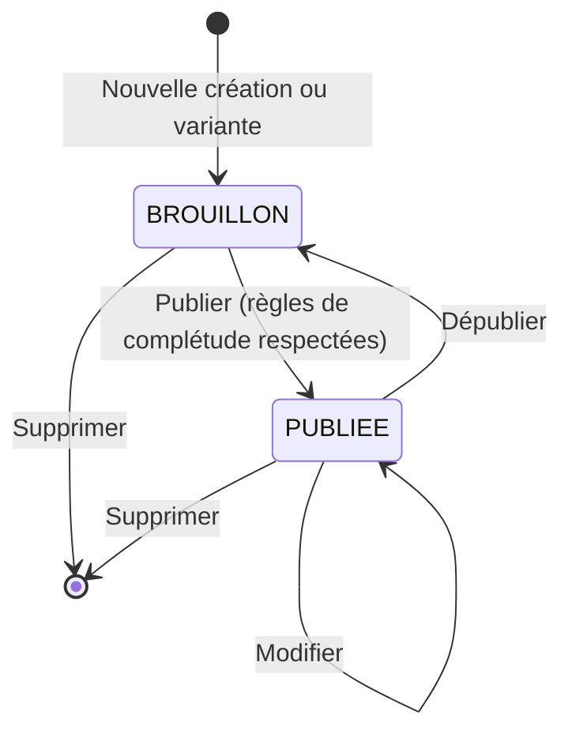

### CV-02 — Contenu (statut de modération, commun à tous les contenus)

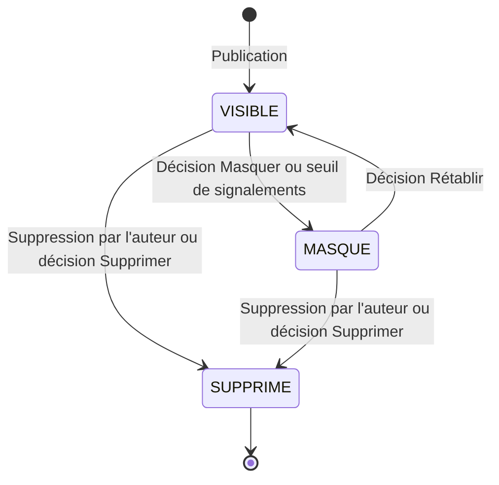

### CV-03 — Sujet

L'état d'un sujet est déduit : « Fermé » s'il a une fermeture enregistrée, « Résolu » s'il a une réponse acceptée, « Ouvert » sinon.

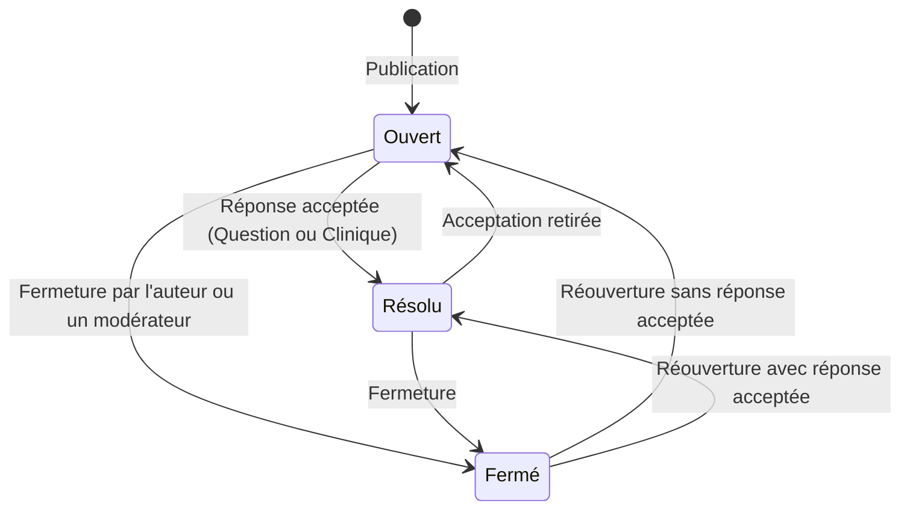

### CV-04 — Cas Bon réflexe

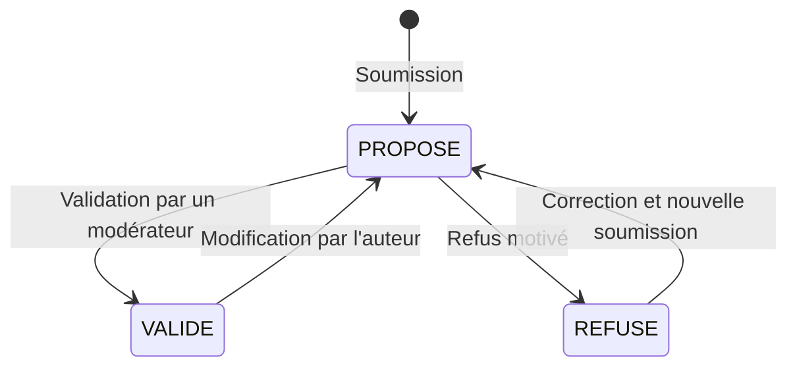

### CV-05 — Défi

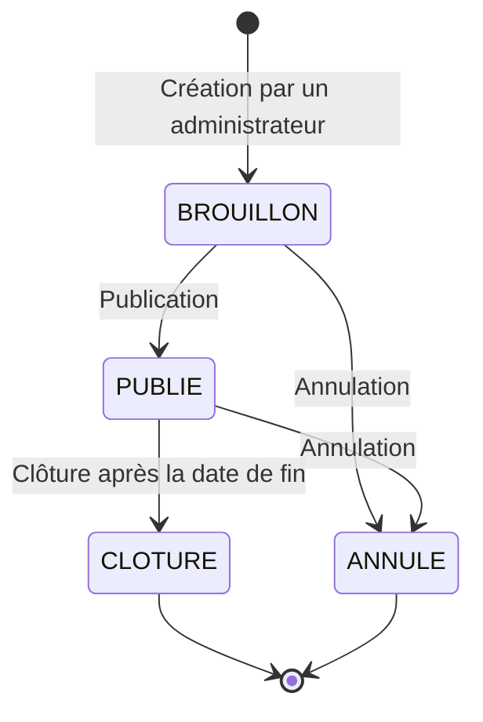

### CV-06 — Signalement

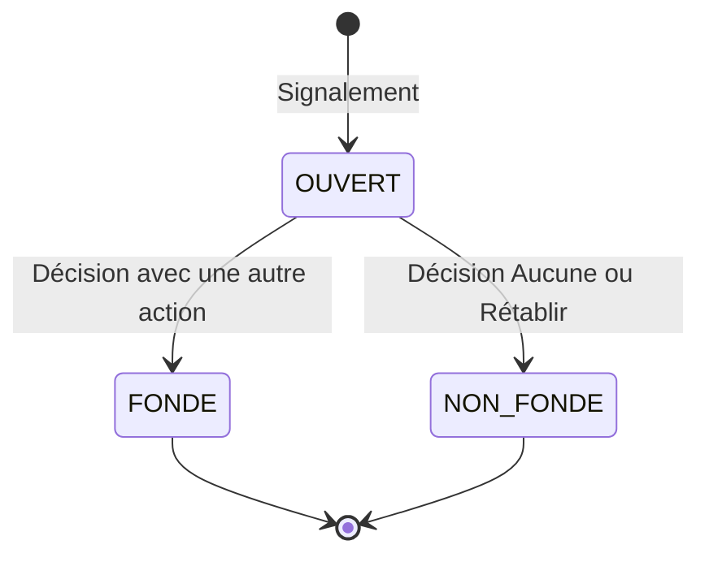

### CV-07 — Compte utilisateur

La suspension n'est pas un statut du compte : elle est déduite d'une décision de suspension en cours (MCD, document 05).

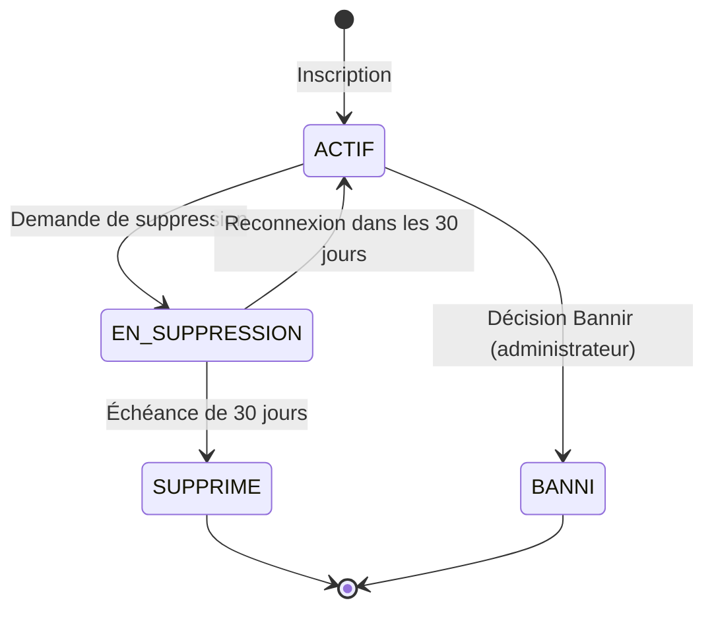

### CV-08 — Demande d'exercice d'un droit

```mermaid
stateDiagram-v2
    [*] --> EN_COURS : Demande d'export ou de suppression
    EN_COURS --> TRAITEE : Export produit ou suppression effectuée
    EN_COURS --> ANNULEE : Reconnexion pendant le délai (suppression)
    TRAITEE --> [*]
    ANNULEE --> [*]
```

---

## 6. Matrice de couverture

Chaque fonctionnalité du document 03 est couverte par au moins un workflow.

| Fonctionnalité | Workflows |
|---|---|
| F-01 | WF-01 |
| F-02 | WF-01 |
| F-03 | WF-02 |
| F-04 | WF-01, WF-03 |
| F-05 | WF-01 |
| F-06 | WF-02, WF-25 |
| F-07 | WF-22 |
| F-08 | WF-23 |
| F-10 | WF-04 |
| F-11 | WF-05 |
| F-12 | WF-06 |
| F-13 | WF-04, WF-06 |
| F-14 | WF-05, WF-06 |
| F-15 | WF-04, WF-06 |
| F-16 | WF-04, WF-07 |
| F-17 | WF-04 |
| F-18 | WF-04 |
| F-19 | WF-04 |
| F-20 | WF-08 |
| F-21 | WF-09, PU-01 |
| F-22 | WF-09 |
| F-23 | WF-09 |
| F-24 | WF-09 |
| F-25 | WF-09 |
| F-26 | PU-03 |
| F-30 | WF-11 |
| F-31 | WF-11, WF-15 |
| F-32 | WF-10 |
| F-33 | WF-10, WF-12 |
| F-34 | WF-11 |
| F-35 | WF-12 |
| F-40 | WF-13 |
| F-41 | WF-13 |
| F-42 | WF-13 |
| F-50 | WF-14, WF-15 |
| F-51 | WF-14 |
| F-52 | WF-14 |
| F-53 | WF-15 |
| F-54 | WF-14 |
| F-55 | WF-16 |
| F-60 | WF-17 |
| F-61 | WF-17 |
| F-62 | WF-18 |
| F-63 | WF-19 |
| F-64 | WF-19 |
| F-65 | WF-19 |
| F-70 | WF-20 |
| F-71 | WF-20 |
| F-72 | WF-04 |
| F-73 | WF-20 |
| F-74 | WF-20 |
| F-75 | WF-20 |
| F-80 | WF-25 |
| F-81 | WF-25 |
| F-90 | WF-21 |
| F-91 | WF-21 |
| F-92 | WF-21 |
| F-93 | WF-21 |
| F-95 | WF-24 |
| F-96 | WF-24 |
| F-97 | PU-05 |
