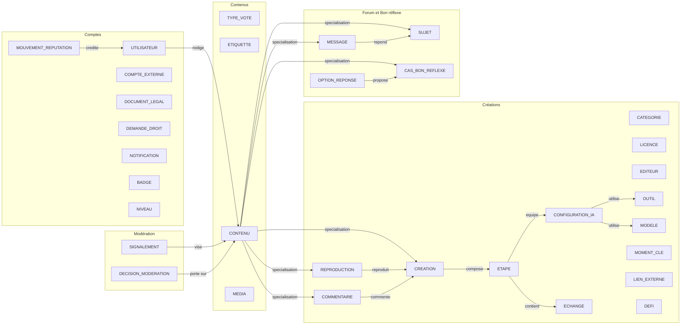
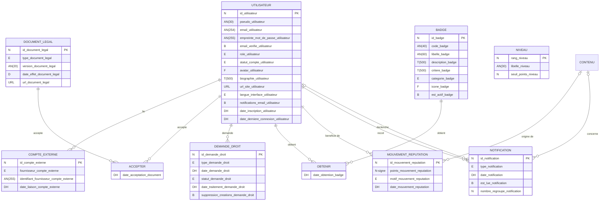
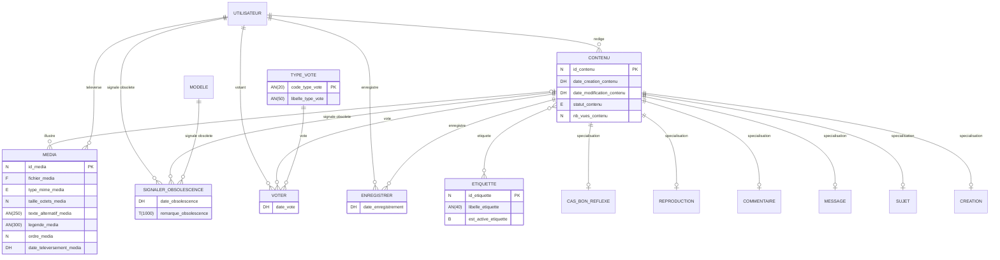
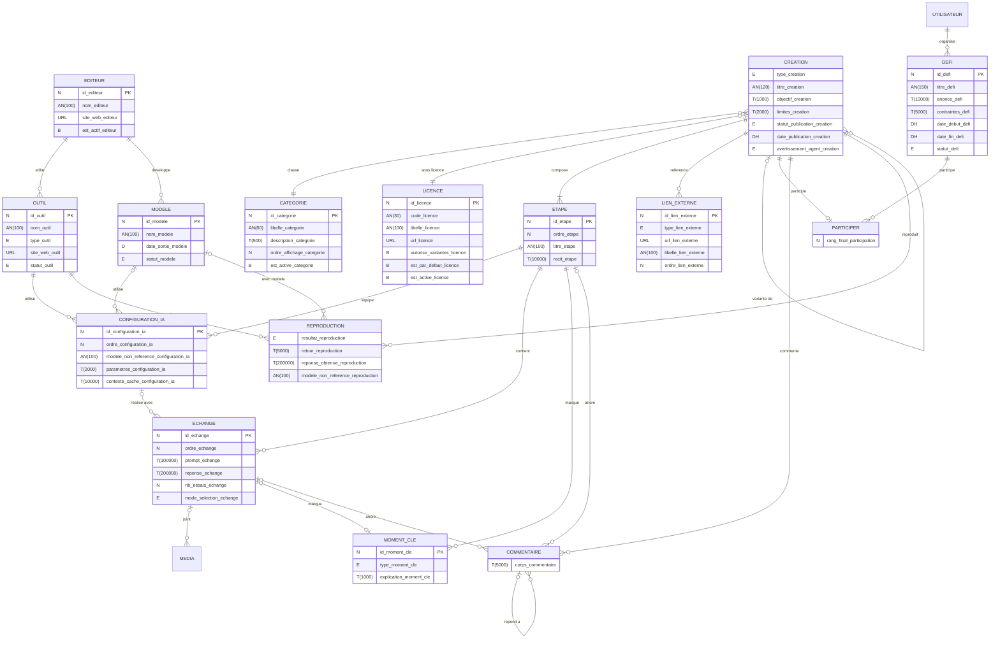
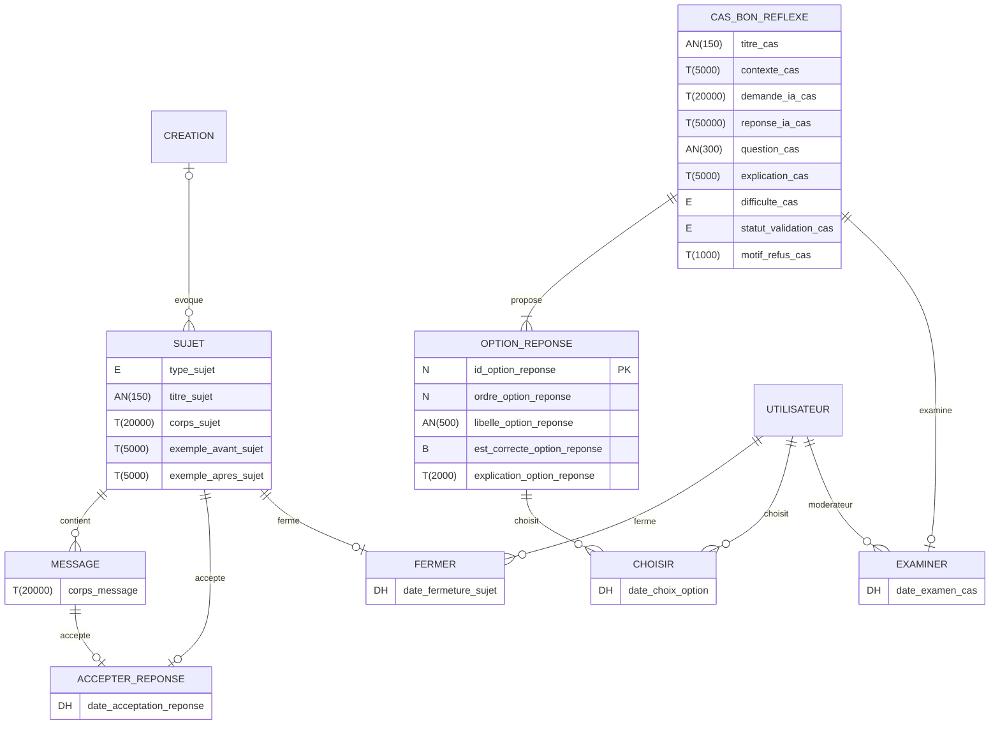
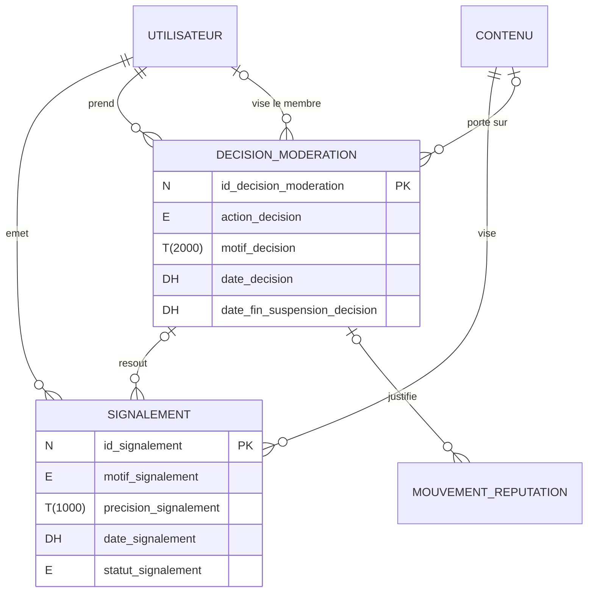

# Vysora — Modèle conceptuel de données (MCD) du MVP

| Élément        | Valeur                                                       |
| -------------- | ------------------------------------------------------------ |
| Projet         | Vysora                                                       |
| Document       | 05 — MCD complet du MVP                                      |
| Version        | 1.0                                                          |
| Date           | 11/10/2026                                                   |
| Statut         | Version de travail soumise à validation du porteur de projet |
| Classification | Confidentiel — diffusion restreinte à l'équipe projet        |

---

## Sommaire

1. [Objet et périmètre](#1-objet-et-périmètre)
2. [Conventions](#2-conventions)
3. [Liste des entités](#3-liste-des-entités)
4. [Dictionnaire des données](#4-dictionnaire-des-données)
5. [Associations](#5-associations)
6. [Généralisation et spécialisation](#6-généralisation-et-spécialisation)
7. [Contraintes d'intégrité](#7-contraintes-dintégrité)
8. [Données calculées](#8-données-calculées)
9. [Diagrammes](#9-diagrammes)
10. [Couverture fonctionnelle](#10-couverture-fonctionnelle)
11. [Indications pour le passage au MLD](#11-indications-pour-le-passage-au-mld)

---

## 1. Objet et périmètre

Ce document décrit le modèle conceptuel de données d'Vysora pour le MVP, selon la méthode Merise, complétée par la généralisation et la spécialisation de Merise/2. Il compte **32 entités**, **54 associations**, **1 généralisation** et **175 propriétés**.

**Couvert :** toutes les fonctionnalités Must et Should du document 03.

**Non couvert :**
- les fonctionnalités Could et Won't (document 03, section 6), dont Carnéo (V2) ;
- les données purement techniques, qui relèvent de la conception technique : sessions, jetons de vérification et de réinitialisation, secrets de double authentification, tentatives de connexion, journaux techniques d'audit autres que les décisions de modération (ENF-09), index de recherche, files d'envoi d'e-mails, mesures d'audience (ENF-12), fichiers d'export ;
- les données calculées, qui ne sont pas stockées au niveau conceptuel (section 8).

## 2. Conventions

### 2.1 Nommage

- **Entités** : nom commun au singulier, en majuscules (`CREATION`).
- **Associations** : verbe à l'infinitif, en majuscules (`REDIGER`).
- **Propriétés** : en minuscules, suffixées par l'entité ou l'association qui les porte (`titre_creation`), pour respecter la règle Merise selon laquelle une propriété n'appartient qu'à un seul objet du modèle. Cette unicité est vérifiée automatiquement.
- **Identifiants** : `id_<entité>`, numériques et non signifiants, sauf `code_type_vote` et `rang_niveau`, qui sont des codes stables. Les sous-types de `CONTENU` n'ont pas d'identifiant propre : ils héritent de `id_contenu`.
- **Valeurs énumérées** : en majuscules, sans accents (`BROUILLON`, `PUBLIEE`).
- **Clés étrangères** : aucune au niveau conceptuel ; elles apparaîtront au passage au MLD (section 11).

### 2.2 Lecture des cardinalités

La cardinalité **(min,max)** est écrite du côté d'une entité. Elle indique combien de fois une occurrence de cette entité participe à l'association.

> Exemple — `REDIGER` : UTILISATEUR **(0,N)** — CONTENU **(1,1)**. Un utilisateur rédige de 0 à N contenus ; un contenu est rédigé par exactement un utilisateur.

### 2.3 Types

| Code | Signification |
|---|---|
| N | Entier positif ou nul |
| N signé | Entier positif ou négatif |
| AN(n) | Texte court de n caractères au plus |
| T(n) | Texte long de n caractères au plus (mise en forme Markdown autorisée pour les textes rédigés) |
| E | Valeur énumérée parmi une liste fermée |
| B | Booléen (vrai ou faux) |
| D | Date |
| DH | Date et heure (UTC) |
| URL | Adresse web de 2 048 caractères au plus |
| F | Référence à un fichier stocké |

Les longueurs maximales sont des valeurs proposées, à confirmer lors de la conception technique.

## 3. Liste des entités

| Entité | Domaine | Description |
|---|---|---|
| `UTILISATEUR` | Comptes | Personne inscrite sur Vysora, quel que soit son rôle. |
| `COMPTE_EXTERNE` | Comptes | Compte GitHub ou Google lié à un utilisateur pour la connexion (F-02). |
| `DOCUMENT_LEGAL` | Comptes | Version d'un document légal à accepter (F-04). |
| `DEMANDE_DROIT` | Comptes | Demande d'exercice d'un droit sur les données personnelles : export ou suppression (F-07, F-08). |
| `MOUVEMENT_REPUTATION` | Comptes | Gain ou perte de points de réputation pour un membre (RG-80 à RG-83). |
| `NOTIFICATION` | Comptes | Information adressée à un membre dans l'application (F-81). |
| `BADGE` | Comptes | Distinction attribuée automatiquement lorsqu'un critère est rempli (RG-86). |
| `NIVEAU` | Comptes | Palier de réputation (RG-84). Entité de paramétrage, sans association : le niveau d'un membre est calculé (section 8). |
| `TYPE_VOTE` | Contenus  | Type de vote possible (RG-41). |
| `ETIQUETTE` | Contenus  | Mot-clé thématique associé aux contenus. |
| `CATEGORIE` | Créations | Nature du résultat d'une création : application web, site, jeu, image, etc. |
| `LICENCE` | Créations | Licence sous laquelle une création est publiée (RG-20). |
| `EDITEUR` | Créations | Entreprise ou organisation qui édite des outils ou développe des modèles d'IA. |
| `OUTIL` | Créations | Application ou interface d'IA utilisée : assistant conversationnel, éditeur de code, générateur d'images, etc. |
| `MODELE` | Créations | Modèle d'IA dans une version donnée. |
| `CONTENU` | Contenus  | Super-type de tout ce qu'un membre rédige et que la communauté peut voir, évaluer ou signaler (section 6). |
| `CREATION` | Créations | Création réalisée avec l'IA et publiée avec son parcours. *(sous-type de CONTENU)* |
| `SUJET` | Forum et Bon réflexe | Sujet du forum : question, Clinique du prompt, astuce, retour d'expérience ou discussion. *(sous-type de CONTENU)* |
| `MESSAGE` | Forum et Bon réflexe | Réponse publiée dans un sujet du forum. *(sous-type de CONTENU)* |
| `COMMENTAIRE` | Créations | Commentaire sur une création, éventuellement ancré à une étape ou à un échange. *(sous-type de CONTENU)* |
| `REPRODUCTION` | Créations | Déclaration d'un membre qui a essayé une création avec ses propres outils (F-32). *(sous-type de CONTENU)* |
| `CAS_BON_REFLEXE` | Forum et Bon réflexe | Cas d'entraînement au jugement des réponses de l'IA (F-60 à F-62). *(sous-type de CONTENU)* |
| `OPTION_REPONSE` | Forum et Bon réflexe | Option de réponse proposée dans un cas Bon réflexe. |
| `ETAPE` | Créations | Segment ordonné du parcours d'une création. Une création « 1 prompt » ou « Itération » a une seule étape. |
| `CONFIGURATION_IA` | Créations | Outil, modèle, paramètres et contexte caché utilisés pour une étape (F-13). |
| `ECHANGE` | Créations | Prompt envoyé à l'IA et réponse obtenue. |
| `MOMENT_CLE` | Créations | Point décisif du parcours signalé par l'auteur (F-14). |
| `LIEN_EXTERNE` | Créations | Lien vers un résultat ou une preuve hébergés ailleurs (F-15). |
| `MEDIA` | Contenus  | Image téléversée par un membre (RG-16). |
| `DEFI` | Créations | Objectif commun proposé pour une période (F-63 à F-65). |
| `SIGNALEMENT` | Modération | Signalement d'un contenu par un membre (F-90). |
| `DECISION_MODERATION` | Modération | Décision prise par un modérateur ou un administrateur, journalisée et non modifiable (RG-102). |

## 4. Dictionnaire des données

L'identifiant de chaque entité est signalé par 🔑.

### 4.1 Comptes, conformité, progression et notifications

#### UTILISATEUR

Personne inscrite sur Vysora, quel que soit son rôle.

| Propriété | Description | Type | Obligatoire | Contraintes et valeurs |
|---|---|---|---|---|
| 🔑 `id_utilisateur` | Identifiant de l'utilisateur | N | Oui | Identifiant, non signifiant |
| `pseudo_utilisateur` | Pseudo public | AN(30) | Oui | Unique sans distinction de casse ; 3 à 30 caractères (RG-01) |
| `email_utilisateur` | Adresse e-mail | AN(254) | Oui, sauf statut SUPPRIME | Unique (RG-02) ; effacée à la suppression (RG-05) |
| `empreinte_mot_de_passe_utilisateur` | Empreinte du mot de passe | AN(255) | Non | Absente si le compte n'utilise qu'un compte externe ; jamais le mot de passe en clair (ENF-05) |
| `email_verifie_utilisateur` | Indique si l'e-mail a été vérifié | B | Oui | Faux à l'inscription par e-mail (RG-02) |
| `role_utilisateur` | Rôle sur la plateforme | E | Oui | MEMBRE, MODERATEUR, ADMINISTRATEUR ; défaut MEMBRE |
| `statut_compte_utilisateur` | Statut du compte | E | Oui | ACTIF, EN_SUPPRESSION, SUPPRIME, BANNI (CV-07) |
| `avatar_utilisateur` | Image de profil | F | Non | Image, mêmes formats et taille que RG-16 |
| `biographie_utilisateur` | Présentation libre | T(500) | Non |  |
| `url_site_utilisateur` | Lien personnel | URL | Non | HTTPS |
| `langue_interface_utilisateur` | Langue d'interface | E | Oui | FR, EN ; défaut FR (D-06) |
| `notifications_email_utilisateur` | Préférence d'envoi par e-mail des notifications importantes | B | Oui | Défaut vrai (F-81) |
| `date_inscription_utilisateur` | Date et heure d'inscription | DH | Oui |  |
| `date_derniere_connexion_utilisateur` | Date et heure de la dernière connexion | DH | Non |  |

#### COMPTE_EXTERNE

Compte GitHub ou Google lié à un utilisateur pour la connexion (F-02).

| Propriété | Description | Type | Obligatoire | Contraintes et valeurs |
|---|---|---|---|---|
| 🔑 `id_compte_externe` | Identifiant du compte externe | N | Oui | Identifiant |
| `fournisseur_compte_externe` | Service d'authentification | E | Oui | GITHUB, GOOGLE |
| `identifiant_fournisseur_compte_externe` | Identifiant de l'utilisateur chez le fournisseur | AN(255) | Oui | Unique par fournisseur |
| `date_liaison_compte_externe` | Date et heure de la liaison | DH | Oui |  |

#### DOCUMENT_LEGAL

Version d'un document légal à accepter (F-04).

| Propriété | Description | Type | Obligatoire | Contraintes et valeurs |
|---|---|---|---|---|
| 🔑 `id_document_legal` | Identifiant du document | N | Oui | Identifiant |
| `type_document_legal` | Type de document | E | Oui | CGU, CONFIDENTIALITE, CHARTE |
| `version_document_legal` | Numéro de version | AN(20) | Oui | Unique par type |
| `date_effet_document_legal` | Date d'entrée en vigueur | D | Oui | RG-112 |
| `url_document_legal` | Adresse du texte complet | URL | Oui |  |

#### DEMANDE_DROIT

Demande d'exercice d'un droit sur les données personnelles : export ou suppression (F-07, F-08).

| Propriété | Description | Type | Obligatoire | Contraintes et valeurs |
|---|---|---|---|---|
| 🔑 `id_demande_droit` | Identifiant de la demande | N | Oui | Identifiant |
| `type_demande_droit` | Droit exercé | E | Oui | EXPORT, SUPPRESSION |
| `date_demande_droit` | Date et heure de la demande | DH | Oui |  |
| `statut_demande_droit` | Statut de la demande | E | Oui | EN_COURS, TRAITEE, ANNULEE (CV-08) |
| `date_traitement_demande_droit` | Date et heure du traitement | DH | Si TRAITEE | Au plus un mois après la demande (RG-06) |
| `suppression_creations_demande_droit` | Le membre demande aussi la suppression de ses créations | B | Si SUPPRESSION | Sans objet pour EXPORT (D-09, RG-05) |

#### MOUVEMENT_REPUTATION

Gain ou perte de points de réputation pour un membre (RG-80 à RG-83).

| Propriété | Description | Type | Obligatoire | Contraintes et valeurs |
|---|---|---|---|---|
| 🔑 `id_mouvement_reputation` | Identifiant du mouvement | N | Oui | Identifiant |
| `points_mouvement_reputation` | Nombre de points, positif ou négatif | N signé | Oui | Barème RG-80 |
| `motif_mouvement_reputation` | Motif du mouvement | E | Oui | VOTE_UTILE_RECU, VOTE_TESTE_RECU, REPRODUCTION_REUSSIE_RECUE, REPONSE_ACCEPTEE, ACCEPTATION_REPONSE, REPRODUCTION_DECLAREE, CAS_VALIDE, CAS_REUSSI, PARTICIPATION_DEFI, PODIUM_DEFI, ANNULATION, AJUSTEMENT_MODERATION |
| `date_mouvement_reputation` | Date et heure du mouvement | DH | Oui | Sert au plafond quotidien (RG-81) et aux classements (RG-87) |

#### NOTIFICATION

Information adressée à un membre dans l'application (F-81).

| Propriété | Description | Type | Obligatoire | Contraintes et valeurs |
|---|---|---|---|---|
| 🔑 `id_notification` | Identifiant de la notification | N | Oui | Identifiant |
| `type_notification` | Événement notifié | E | Oui | COMMENTAIRE_RECU, REPONSE_COMMENTAIRE, REPONSE_SUJET, REPONSE_ACCEPTEE, REPRODUCTION_RECUE, VARIANTE_PUBLIEE, OBSOLESCENCE_SIGNALEE, VOTES_UTILE_RECUS, BADGE_OBTENU, NIVEAU_ATTEINT, CAS_VALIDE, CAS_REFUSE, RESULTAT_DEFI, CONTENU_MASQUE, CONTENU_RETABLI, DECISION_MODERATION (RG-91) |
| `date_notification` | Date et heure de création | DH | Oui |  |
| `est_lue_notification` | Indique si la notification a été lue | B | Oui | Défaut faux |
| `nombre_regroupe_notification` | Nombre d'événements regroupés | N | Oui | ≥ 1 ; > 1 pour les votes regroupés par contenu et par jour (RG-91) |

#### BADGE

Distinction attribuée automatiquement lorsqu'un critère est rempli (RG-86).

| Propriété | Description | Type | Obligatoire | Contraintes et valeurs |
|---|---|---|---|---|
| 🔑 `id_badge` | Identifiant du badge | N | Oui | Identifiant |
| `code_badge` | Code technique stable | AN(40) | Oui | Unique ; ex. PREMIERE_CREATION |
| `libelle_badge` | Nom affiché | AN(60) | Oui |  |
| `description_badge` | Description | T(500) | Oui |  |
| `critere_badge` | Critère d'obtention en clair | T(500) | Oui |  |
| `categorie_badge` | Famille de badge | E | Oui | CONTRIBUTION, APPRENTISSAGE, COMMUNAUTE |
| `icone_badge` | Image du badge | F | Oui |  |
| `est_actif_badge` | Badge encore attribuable | B | Oui | RG-110 |

#### NIVEAU

Palier de réputation (RG-84). Entité de paramétrage, sans association : le niveau d'un membre est calculé (section 8).

| Propriété | Description | Type | Obligatoire | Contraintes et valeurs |
|---|---|---|---|---|
| 🔑 `rang_niveau` | Rang du niveau | N | Oui | Identifiant ; 1 à 5 |
| `libelle_niveau` | Nom du niveau | AN(30) | Oui | Curieux, Apprenti, Artisan, Expert, Maître |
| `seuil_points_niveau` | Réputation minimale pour atteindre le niveau | N | Oui | Strictement croissant avec le rang ; 0 pour le rang 1 |

### 4.2 Contenus : généralisation et interactions communes

#### TYPE_VOTE

Type de vote possible (RG-41).

| Propriété | Description | Type | Obligatoire | Contraintes et valeurs |
|---|---|---|---|---|
| 🔑 `code_type_vote` | Code du type de vote | AN(20) | Oui | Identifiant ; UTILE, TESTE_OK |
| `libelle_type_vote` | Libellé affiché | AN(50) | Oui | « Utile », « Testé, ça marche » |

#### ETIQUETTE

Mot-clé thématique associé aux contenus.

| Propriété | Description | Type | Obligatoire | Contraintes et valeurs |
|---|---|---|---|---|
| 🔑 `id_etiquette` | Identifiant de l'étiquette | N | Oui | Identifiant |
| `libelle_etiquette` | Libellé | AN(40) | Oui | Unique sans distinction de casse |
| `est_active_etiquette` | Étiquette proposée à la saisie | B | Oui | RG-110 |

#### CONTENU

Super-type de tout ce qu'un membre rédige et que la communauté peut voir, évaluer ou signaler (section 6).

| Propriété | Description | Type | Obligatoire | Contraintes et valeurs |
|---|---|---|---|---|
| 🔑 `id_contenu` | Identifiant du contenu | N | Oui | Identifiant, hérité par les sous-types |
| `date_creation_contenu` | Date et heure de création | DH | Oui |  |
| `date_modification_contenu` | Date et heure de dernière modification | DH | Non | RG-18 |
| `statut_contenu` | Statut de modération | E | Oui | VISIBLE, MASQUE, SUPPRIME (CV-02) |
| `nb_vues_contenu` | Nombre de vues | N | Oui | ≥ 0 ; au plus une vue par visiteur et par jour (F-23) |

#### MEDIA

Image téléversée par un membre (RG-16).

| Propriété | Description | Type | Obligatoire | Contraintes et valeurs |
|---|---|---|---|---|
| 🔑 `id_media` | Identifiant du média | N | Oui | Identifiant |
| `fichier_media` | Fichier image | F | Oui |  |
| `type_mime_media` | Format | E | Oui | image/png, image/jpeg, image/webp, image/gif |
| `taille_octets_media` | Taille du fichier | N | Oui | ≤ 5 242 880 octets (5 Mo) |
| `texte_alternatif_media` | Description pour les lecteurs d'écran | AN(250) | Oui | ENF-01 |
| `legende_media` | Légende affichée | AN(300) | Non |  |
| `ordre_media` | Ordre d'affichage | N | Oui |  |
| `date_televersement_media` | Date et heure du téléversement | DH | Oui |  |

### 4.3 Créations, parcours, référentiels IA, reproductions, commentaires et défis

#### CATEGORIE

Nature du résultat d'une création : application web, site, jeu, image, etc.

| Propriété | Description | Type | Obligatoire | Contraintes et valeurs |
|---|---|---|---|---|
| 🔑 `id_categorie` | Identifiant de la catégorie | N | Oui | Identifiant |
| `libelle_categorie` | Libellé | AN(60) | Oui | Unique |
| `description_categorie` | Description | T(500) | Non |  |
| `ordre_affichage_categorie` | Ordre d'affichage | N | Oui |  |
| `est_active_categorie` | Catégorie proposée à la saisie | B | Oui | RG-110 |

#### LICENCE

Licence sous laquelle une création est publiée (RG-20).

| Propriété | Description | Type | Obligatoire | Contraintes et valeurs |
|---|---|---|---|---|
| 🔑 `id_licence` | Identifiant de la licence | N | Oui | Identifiant |
| `code_licence` | Code | AN(30) | Oui | Unique ; ex. CC-BY-4.0 |
| `libelle_licence` | Libellé | AN(100) | Oui |  |
| `url_licence` | Adresse du texte de la licence | URL | Oui |  |
| `autorise_variantes_licence` | La licence permet de publier des variantes | B | Oui | Faux pour « Tous droits réservés » (RG-21) |
| `est_par_defaut_licence` | Licence proposée par défaut | B | Oui | Une seule licence par défaut (D-07) |
| `est_active_licence` | Licence proposée à la saisie | B | Oui | RG-110 |

#### EDITEUR

Entreprise ou organisation qui édite des outils ou développe des modèles d'IA.

| Propriété | Description | Type | Obligatoire | Contraintes et valeurs |
|---|---|---|---|---|
| 🔑 `id_editeur` | Identifiant de l'éditeur | N | Oui | Identifiant |
| `nom_editeur` | Nom | AN(100) | Oui | Unique |
| `site_web_editeur` | Site web | URL | Non |  |
| `est_actif_editeur` | Éditeur proposé à la saisie | B | Oui | RG-110 |

#### OUTIL

Application ou interface d'IA utilisée : assistant conversationnel, éditeur de code, générateur d'images, etc.

| Propriété | Description | Type | Obligatoire | Contraintes et valeurs |
|---|---|---|---|---|
| 🔑 `id_outil` | Identifiant de l'outil | N | Oui | Identifiant |
| `nom_outil` | Nom | AN(100) | Oui | Unique |
| `type_outil` | Famille d'outil | E | Oui | ASSISTANT_CONVERSATIONNEL, EDITEUR_CODE, AGENT_CODE, CONSTRUCTEUR_APPLICATION, GENERATEUR_IMAGE, GENERATEUR_VIDEO, GENERATEUR_AUDIO, AUTRE |
| `site_web_outil` | Site web | URL | Non |  |
| `statut_outil` | Statut | E | Oui | ACTIF, ARCHIVE (RG-110) |

#### MODELE

Modèle d'IA dans une version donnée.

| Propriété | Description | Type | Obligatoire | Contraintes et valeurs |
|---|---|---|---|---|
| 🔑 `id_modele` | Identifiant du modèle | N | Oui | Identifiant |
| `nom_modele` | Nom et version | AN(100) | Oui | Unique par éditeur |
| `date_sortie_modele` | Date de mise à disposition | D | Non |  |
| `statut_modele` | Statut | E | Oui | DISPONIBLE, RETIRE (RG-110) |

#### CREATION — sous-type de CONTENU (identifiant hérité : `id_contenu`)

Création réalisée avec l'IA et publiée avec son parcours.

| Propriété | Description | Type | Obligatoire | Contraintes et valeurs |
|---|---|---|---|---|
| `type_creation` | Type de création | E | Oui | UN_PROMPT, ITERATION, PROJET ; non modifiable après publication (RG-18) |
| `titre_creation` | Titre | AN(120) | Oui | 10 à 120 caractères (RG-10) |
| `objectif_creation` | Ce que l'auteur voulait obtenir | T(1000) | Oui | 20 à 1 000 caractères (RG-10) |
| `limites_creation` | Limites constatées | T(2000) | Non |  |
| `statut_publication_creation` | Statut de publication | E | Oui | BROUILLON, PUBLIEE ; défaut BROUILLON (CV-01, D-10) |
| `date_publication_creation` | Date et heure de première publication | DH | Si publiée au moins une fois |  |
| `avertissement_agent_creation` | Avertissement « instructions pour agent » et son origine | E | Oui | AUCUN, AUTEUR, MODERATION ; défaut AUCUN (RG-23) |

#### COMMENTAIRE — sous-type de CONTENU (identifiant hérité : `id_contenu`)

Commentaire sur une création, éventuellement ancré à une étape ou à un échange.

| Propriété | Description | Type | Obligatoire | Contraintes et valeurs |
|---|---|---|---|---|
| `corps_commentaire` | Texte du commentaire | T(5000) | Oui | 1 à 5 000 caractères (RG-50) |

#### REPRODUCTION — sous-type de CONTENU (identifiant hérité : `id_contenu`)

Déclaration d'un membre qui a essayé une création avec ses propres outils (F-32).

| Propriété | Description | Type | Obligatoire | Contraintes et valeurs |
|---|---|---|---|---|
| `resultat_reproduction` | Résultat obtenu | E | Oui | SUCCES, PARTIEL, ECHEC |
| `retour_reproduction` | Explication du résultat | T(5000) | Si PARTIEL ou ECHEC | 20 caractères minimum dans ce cas (RG-42) |
| `reponse_obtenue_reproduction` | Réponse obtenue par le membre | T(200000) | Non |  |
| `modele_non_reference_reproduction` | Modèle saisi en texte libre s'il est absent du référentiel | AN(100) | Non | Exclusif du modèle référencé (CI-13) |

#### ETAPE

Segment ordonné du parcours d'une création. Une création « 1 prompt » ou « Itération » a une seule étape.

| Propriété | Description | Type | Obligatoire | Contraintes et valeurs |
|---|---|---|---|---|
| 🔑 `id_etape` | Identifiant de l'étape | N | Oui | Identifiant |
| `ordre_etape` | Position dans le parcours | N | Oui | Unique dans la création |
| `titre_etape` | Titre | AN(100) | Si PROJET | 5 à 100 caractères (RG-13) |
| `recit_etape` | Récit de l'étape | T(10000) | Si PROJET | 50 caractères minimum (RG-13) |

#### CONFIGURATION_IA

Outil, modèle, paramètres et contexte caché utilisés pour une étape (F-13).

| Propriété | Description | Type | Obligatoire | Contraintes et valeurs |
|---|---|---|---|---|
| 🔑 `id_configuration_ia` | Identifiant de la configuration | N | Oui | Identifiant |
| `ordre_configuration_ia` | Ordre d'affichage dans l'étape | N | Oui |  |
| `modele_non_reference_configuration_ia` | Modèle saisi en texte libre s'il est absent du référentiel | AN(100) | Non | Exclusif du modèle référencé (RG-14) |
| `parametres_configuration_ia` | Paramètres et modes activés | T(2000) | Non | Ex. réflexion étendue, recherche web, température |
| `contexte_cache_configuration_ia` | Instructions personnalisées, mémoire, fichiers de règles, pièces jointes | T(10000) | Non |  |

#### ECHANGE

Prompt envoyé à l'IA et réponse obtenue.

| Propriété | Description | Type | Obligatoire | Contraintes et valeurs |
|---|---|---|---|---|
| 🔑 `id_echange` | Identifiant de l'échange | N | Oui | Identifiant |
| `ordre_echange` | Position dans l'étape | N | Oui | Unique dans l'étape |
| `prompt_echange` | Texte exact du prompt | T(100000) | Oui |  |
| `reponse_echange` | Réponse textuelle de l'IA | T(200000) | Non | Réponse ou image obligatoire selon RG-11 et RG-12 |
| `nb_essais_echange` | Nombre d'essais réalisés pour ce prompt | N | Oui | ≥ 1 ; défaut 1 (RG-11) |
| `mode_selection_echange` | Choix du résultat présenté | E | Oui | PREMIER_ESSAI, MEILLEUR_ESSAI ; PREMIER_ESSAI si un seul essai |

#### MOMENT_CLE

Point décisif du parcours signalé par l'auteur (F-14).

| Propriété | Description | Type | Obligatoire | Contraintes et valeurs |
|---|---|---|---|---|
| 🔑 `id_moment_cle` | Identifiant du moment clé | N | Oui | Identifiant |
| `type_moment_cle` | Nature du moment | E | Oui | CORRECTION, REFUS, ECHEC, CHANGEMENT_OUTIL, VERIFICATION, DECOUVERTE |
| `explication_moment_cle` | Ce qui s'est passé et pourquoi c'était décisif | T(1000) | Oui | 20 à 1 000 caractères (RG-15) |

#### LIEN_EXTERNE

Lien vers un résultat ou une preuve hébergés ailleurs (F-15).

| Propriété | Description | Type | Obligatoire | Contraintes et valeurs |
|---|---|---|---|---|
| 🔑 `id_lien_externe` | Identifiant du lien | N | Oui | Identifiant |
| `type_lien_externe` | Nature du lien | E | Oui | DEMO, DEPOT_CODE, VIDEO, PREUVE, ARTICLE, AUTRE |
| `url_lien_externe` | Adresse | URL | Oui | HTTPS (RG-16) |
| `libelle_lien_externe` | Libellé affiché | AN(100) | Non |  |
| `ordre_lien_externe` | Ordre d'affichage | N | Oui |  |

#### DEFI

Objectif commun proposé pour une période (F-63 à F-65).

| Propriété | Description | Type | Obligatoire | Contraintes et valeurs |
|---|---|---|---|---|
| 🔑 `id_defi` | Identifiant du défi | N | Oui | Identifiant |
| `titre_defi` | Titre | AN(150) | Oui |  |
| `enonce_defi` | Énoncé | T(10000) | Oui |  |
| `contraintes_defi` | Contraintes à respecter | T(5000) | Non |  |
| `date_debut_defi` | Début de la période | DH | Oui |  |
| `date_fin_defi` | Fin de la période | DH | Oui | Postérieure au début ; durée de 1 à 30 jours (RG-73) |
| `statut_defi` | Statut | E | Oui | BROUILLON, PUBLIE, CLOTURE, ANNULE (CV-05) |

### 4.4 Forum et Bon réflexe

#### SUJET — sous-type de CONTENU (identifiant hérité : `id_contenu`)

Sujet du forum : question, Clinique du prompt, astuce, retour d'expérience ou discussion.

| Propriété | Description | Type | Obligatoire | Contraintes et valeurs |
|---|---|---|---|---|
| `type_sujet` | Type de sujet | E | Oui | QUESTION, CLINIQUE, ASTUCE, RETOUR_EXPERIENCE, DISCUSSION |
| `titre_sujet` | Titre | AN(150) | Oui | 15 à 150 caractères (RG-60) |
| `corps_sujet` | Corps du sujet | T(20000) | Oui | 30 à 20 000 caractères ; rubriques obligatoires pour CLINIQUE (RG-62) |
| `exemple_avant_sujet` | Exemple avant application de l'astuce | T(5000) | Si ASTUCE | 20 caractères minimum (RG-61) |
| `exemple_apres_sujet` | Exemple après application de l'astuce | T(5000) | Si ASTUCE | 20 caractères minimum (RG-61) |

#### MESSAGE — sous-type de CONTENU (identifiant hérité : `id_contenu`)

Réponse publiée dans un sujet du forum.

| Propriété | Description | Type | Obligatoire | Contraintes et valeurs |
|---|---|---|---|---|
| `corps_message` | Texte de la réponse | T(20000) | Oui | 20 à 20 000 caractères (RG-64) |

#### CAS_BON_REFLEXE — sous-type de CONTENU (identifiant hérité : `id_contenu`)

Cas d'entraînement au jugement des réponses de l'IA (F-60 à F-62).

| Propriété | Description | Type | Obligatoire | Contraintes et valeurs |
|---|---|---|---|---|
| `titre_cas` | Titre | AN(150) | Oui |  |
| `contexte_cas` | Situation de départ | T(5000) | Oui |  |
| `demande_ia_cas` | Demande faite à l'IA | T(20000) | Oui |  |
| `reponse_ia_cas` | Réponse fournie par l'IA | T(50000) | Oui |  |
| `question_cas` | Question posée à l'apprenant | AN(300) | Oui |  |
| `explication_cas` | Explication générale de l'expert | T(5000) | Oui | 50 caractères minimum (RG-70) |
| `difficulte_cas` | Difficulté | E | Oui | DEBUTANT, INTERMEDIAIRE, AVANCE |
| `statut_validation_cas` | Statut de validation | E | Oui | PROPOSE, VALIDE, REFUSE (CV-04) |
| `motif_refus_cas` | Motif du refus | T(1000) | Si REFUSE | RG-71 |

#### OPTION_REPONSE

Option de réponse proposée dans un cas Bon réflexe.

| Propriété | Description | Type | Obligatoire | Contraintes et valeurs |
|---|---|---|---|---|
| 🔑 `id_option_reponse` | Identifiant de l'option | N | Oui | Identifiant |
| `ordre_option_reponse` | Ordre d'affichage | N | Oui | Unique dans le cas |
| `libelle_option_reponse` | Texte de l'option | AN(500) | Oui |  |
| `est_correcte_option_reponse` | Indique la bonne réponse | B | Oui | Exactement une par cas (RG-70) |
| `explication_option_reponse` | Pourquoi cette option est juste ou fausse | T(2000) | Oui |  |

### 4.5 Modération

#### SIGNALEMENT

Signalement d'un contenu par un membre (F-90).

| Propriété | Description | Type | Obligatoire | Contraintes et valeurs |
|---|---|---|---|---|
| 🔑 `id_signalement` | Identifiant du signalement | N | Oui | Identifiant |
| `motif_signalement` | Motif | E | Oui | SPAM, ILLICITE, DANGEREUX, DONNEES_PERSONNELLES, PLAGIAT, HARCELEMENT, HORS_SUJET, AUTRE |
| `precision_signalement` | Précision | T(1000) | Si AUTRE | RG-100 |
| `date_signalement` | Date et heure | DH | Oui |  |
| `statut_signalement` | Statut | E | Oui | OUVERT, FONDE, NON_FONDE (CV-06) |

#### DECISION_MODERATION

Décision prise par un modérateur ou un administrateur, journalisée et non modifiable (RG-102).

| Propriété | Description | Type | Obligatoire | Contraintes et valeurs |
|---|---|---|---|---|
| 🔑 `id_decision_moderation` | Identifiant de la décision | N | Oui | Identifiant |
| `action_decision` | Action décidée | E | Oui | AUCUNE, MASQUER, RETABLIR, SUPPRIMER, AVERTIR, SUSPENDRE, AJOUTER_AVERTISSEMENT_AGENT, RETIRER_AVERTISSEMENT_AGENT, BANNIR, AJUSTER_REPUTATION, RETIRER_BADGE |
| `motif_decision` | Motif communiqué | T(2000) | Oui |  |
| `date_decision` | Date et heure | DH | Oui |  |
| `date_fin_suspension_decision` | Fin de la suspension | DH | Si SUSPENDRE | 1 à 90 jours après la décision (F-91) |

## 5. Associations

Les associations qui portent des propriétés (associations porteuses) les listent dans la colonne « Propriétés ».

### 5.1 Comptes, conformité, progression et notifications

| Association | Participants et cardinalités | Propriétés | Signification |
|---|---|---|---|
| `LIER` | UTILISATEUR **(0,N)** — COMPTE_EXTERNE **(1,1)** | — | Un utilisateur lie de 0 à N comptes externes ; un compte externe appartient à un seul utilisateur. |
| `ACCEPTER` | UTILISATEUR **(0,N)** — DOCUMENT_LEGAL **(0,N)** | `date_acceptation_document` (DH) : Date et heure de l'acceptation | Un utilisateur accepte des versions de documents légaux ; une version est acceptée par de nombreux utilisateurs. |
| `DEMANDER` | UTILISATEUR **(0,N)** — DEMANDE_DROIT **(1,1)** | — | Un utilisateur formule de 0 à N demandes ; une demande émane d'un seul utilisateur. |
| `OBTENIR` | UTILISATEUR **(0,N)** — BADGE **(0,N)** | `date_obtention_badge` (DH) : Date et heure d'obtention | Un membre obtient chaque badge au plus une fois. |
| `CREDITER` | UTILISATEUR **(0,N)** — MOUVEMENT_REPUTATION **(1,1)** | — | Un mouvement de réputation concerne un seul membre. |
| `ORIGINER` | CONTENU **(0,N)** — MOUVEMENT_REPUTATION **(0,1)** | — | Un mouvement peut avoir pour origine un contenu (le contenu voté, accepté, reproduit…). |
| `DESTINER` | UTILISATEUR **(0,N)** — NOTIFICATION **(1,1)** | — | Une notification a un seul destinataire. |
| `DECLENCHER` | UTILISATEUR **(0,N)** — NOTIFICATION **(0,1)** | — | Une notification peut avoir été déclenchée par un autre membre (absent pour les notifications regroupées ou système). |
| `CONCERNER` | CONTENU **(0,N)** — NOTIFICATION **(0,1)** | — | Une notification peut porter sur un contenu. |

### 5.2 Contenus : généralisation et interactions communes

| Association | Participants et cardinalités | Propriétés | Signification |
|---|---|---|---|
| `REDIGER` | UTILISATEUR **(0,N)** — CONTENU **(1,1)** | — | Tout contenu a un et un seul auteur. |
| `VOTER` | UTILISATEUR [votant] **(0,N)** — CONTENU **(0,N)** — TYPE_VOTE **(0,N)** | `date_vote` (DH) : Date et heure du vote | Un membre émet au plus un vote de chaque type sur un contenu (RG-40). |
| `ENREGISTRER` | UTILISATEUR **(0,N)** — CONTENU **(0,N)** | `date_enregistrement` (DH) : Date et heure de l'enregistrement | Un membre enregistre un contenu au plus une fois (RG-45). |
| `SIGNALER_OBSOLESCENCE` | UTILISATEUR **(0,N)** — CONTENU **(0,N)** — MODELE **(0,N)** | `date_obsolescence` (DH) : Date et heure du signalement<br>`remarque_obsolescence` (T(1000)) : Remarque | Un membre signale au plus une fois qu'un contenu ne fonctionne plus avec un modèle donné (RG-44). |
| `ETIQUETER` | CONTENU **(0,N)** — ETIQUETTE **(0,N)** | — | Un contenu porte des étiquettes ; une étiquette marque de nombreux contenus. |
| `ILLUSTRER` | CONTENU **(0,N)** — MEDIA **(0,1)** | — | Un contenu est illustré par des images ; une image illustre au plus un contenu. |
| `TELEVERSER` | UTILISATEUR **(0,N)** — MEDIA **(1,1)** | — | Une image est téléversée par un seul membre. |

### 5.3 Créations, parcours, référentiels IA, reproductions, commentaires et défis

| Association | Participants et cardinalités | Propriétés | Signification |
|---|---|---|---|
| `CLASSER` | CREATION **(1,1)** — CATEGORIE **(0,N)** | — | Une création appartient à une seule catégorie. |
| `PLACER_SOUS` | CREATION **(1,1)** — LICENCE **(0,N)** | — | Une création est publiée sous une seule licence. |
| `COMPOSER` | CREATION **(1,N)** — ETAPE **(1,1)** | — | Une création se compose d'au moins une étape ; une étape appartient à une seule création. |
| `EQUIPER` | ETAPE **(0,N)** — CONFIGURATION_IA **(1,1)** | — | Une étape utilise de 0 à N configurations IA ; une configuration appartient à une seule étape. |
| `UTILISER_OUTIL` | OUTIL **(0,N)** — CONFIGURATION_IA **(1,1)** | — | Une configuration désigne un seul outil. |
| `UTILISER_MODELE` | MODELE **(0,N)** — CONFIGURATION_IA **(0,1)** | — | Une configuration désigne au plus un modèle référencé. |
| `CONTENIR` | ETAPE **(0,N)** — ECHANGE **(1,1)** | — | Une étape contient de 0 à N échanges ; un échange appartient à une seule étape. |
| `REALISER_AVEC` | CONFIGURATION_IA **(0,N)** — ECHANGE **(0,1)** | — | Un échange désigne la configuration utilisée lorsque son étape en a plusieurs (RG-14). |
| `JOINDRE` | ECHANGE **(0,N)** — MEDIA **(0,1)** | — | Des images peuvent être jointes à un échange ; une image est jointe à au plus un échange. |
| `MARQUER_ETAPE` | ETAPE **(0,N)** — MOMENT_CLE **(1,1)** | — | Un moment clé est rattaché à une seule étape. |
| `MARQUER_ECHANGE` | ECHANGE **(0,1)** — MOMENT_CLE **(0,1)** | — | Un moment clé peut viser un échange ; un échange porte au plus un moment clé (RG-15). |
| `REFERENCER` | CREATION **(0,N)** — LIEN_EXTERNE **(1,1)** | — | Une création référence de 0 à N liens externes. |
| `DERIVER` | CREATION [source] **(0,N)** — CREATION [variante] **(0,1)** | — | Une variante dérive d'une seule création source ; une source a de 0 à N variantes (RG-21). |
| `PARTICIPER` | DEFI **(0,N)** — CREATION **(0,1)** | `rang_final_participation` (N) : Rang figé à la clôture du défi | Une création participe à au plus un défi (RG-74). |
| `ORGANISER` | UTILISATEUR **(0,N)** — DEFI **(1,1)** | — | Un défi est créé par un seul administrateur. |
| `COMMENTER` | CREATION **(0,N)** — COMMENTAIRE **(1,1)** | — | Un commentaire porte sur une seule création. |
| `REPONDRE_COMMENTAIRE` | COMMENTAIRE [parent] **(0,N)** — COMMENTAIRE [reponse] **(0,1)** | — | Une réponse se rattache à un seul commentaire parent ; un parent a de 0 à N réponses (un seul niveau, RG-50). |
| `ANCRER_ETAPE` | ETAPE **(0,N)** — COMMENTAIRE **(0,1)** | — | Un commentaire peut être ancré à une étape. |
| `ANCRER_ECHANGE` | ECHANGE **(0,N)** — COMMENTAIRE **(0,1)** | — | Un commentaire peut être ancré à un échange. |
| `REPRODUIRE` | CREATION **(0,N)** — REPRODUCTION **(1,1)** | — | Une reproduction porte sur une seule création. |
| `REPRODUIRE_AVEC_OUTIL` | OUTIL **(0,N)** — REPRODUCTION **(1,1)** | — | Une reproduction indique un seul outil. |
| `REPRODUIRE_AVEC_MODELE` | MODELE **(0,N)** — REPRODUCTION **(0,1)** | — | Une reproduction indique au plus un modèle référencé. |
| `EDITER` | EDITEUR **(0,N)** — OUTIL **(1,1)** | — | Un outil est édité par un seul éditeur. |
| `DEVELOPPER` | EDITEUR **(0,N)** — MODELE **(1,1)** | — | Un modèle est développé par un seul éditeur. |

### 5.4 Forum et Bon réflexe

| Association | Participants et cardinalités | Propriétés | Signification |
|---|---|---|---|
| `REPONDRE` | SUJET **(0,N)** — MESSAGE **(1,1)** | — | Une réponse appartient à un seul sujet. |
| `ACCEPTER_REPONSE` | SUJET **(0,1)** — MESSAGE **(0,1)** | `date_acceptation_reponse` (DH) : Date et heure de l'acceptation | Un sujet a au plus une réponse acceptée (RG-63). |
| `FERMER` | UTILISATEUR **(0,N)** — SUJET **(0,1)** | `date_fermeture_sujet` (DH) : Date et heure de la fermeture | Un sujet fermé l'a été par un seul membre (auteur ou modérateur) ; supprimée à la réouverture (RG-65). |
| `EVOQUER` | CREATION **(0,N)** — SUJET **(0,1)** | — | Un sujet peut concerner une création publiée (RG-66). |
| `PROPOSER` | CAS_BON_REFLEXE **(1,N)** — OPTION_REPONSE **(1,1)** | — | Un cas propose des options de réponse (2 à 5, CI-16) ; une option appartient à un seul cas. |
| `CHOISIR` | UTILISATEUR **(0,N)** — OPTION_REPONSE **(0,N)** | `date_choix_option` (DH) : Date et heure de la réponse | Un membre choisit une option par cas, définitivement (RG-72). |
| `EXAMINER` | UTILISATEUR [moderateur] **(0,N)** — CAS_BON_REFLEXE **(0,1)** | `date_examen_cas` (DH) : Date et heure de la validation ou du refus | Un cas validé ou refusé l'a été par un seul modérateur ; supprimée à une nouvelle soumission (RG-71). |

### 5.5 Modération

| Association | Participants et cardinalités | Propriétés | Signification |
|---|---|---|---|
| `EMETTRE` | UTILISATEUR **(0,N)** — SIGNALEMENT **(1,1)** | — | Un signalement est émis par un seul membre. |
| `VISER` | CONTENU **(0,N)** — SIGNALEMENT **(1,1)** | — | Un signalement vise un seul contenu. |
| `RESOUDRE` | DECISION_MODERATION **(0,N)** — SIGNALEMENT **(0,1)** | — | Un signalement clos l'a été par une seule décision ; une décision clôt de 0 à N signalements. |
| `PRENDRE` | UTILISATEUR [moderateur] **(0,N)** — DECISION_MODERATION **(1,1)** | — | Une décision est prise par un seul modérateur ou administrateur. |
| `PORTER_SUR` | CONTENU **(0,N)** — DECISION_MODERATION **(0,1)** | — | Une décision peut porter sur un contenu. |
| `SANCTIONNER` | UTILISATEUR [sanctionne] **(0,N)** — DECISION_MODERATION **(0,1)** | — | Une décision peut viser un membre (avertissement, suspension, bannissement, ajustement, retrait de badge). |
| `JUSTIFIER` | DECISION_MODERATION **(0,N)** — MOUVEMENT_REPUTATION **(0,1)** | — | Un mouvement d'ajustement est justifié par une décision (CI-24). |

**Associations ternaires :** `VOTER`, `SIGNALER_OBSOLESCENCE`. Leur identifiant est le triplet des identifiants des entités participantes : par exemple, un membre ne peut voter qu'une fois par contenu et par type de vote.

**Associations réflexives :** `DERIVER` (rôles source et variante) et `REPONDRE_COMMENTAIRE` (rôles parent et réponse).

## 6. Généralisation et spécialisation

```text
                              CONTENU
        (id_contenu, date_creation_contenu, date_modification_contenu,
                   statut_contenu, nb_vues_contenu)
                                 │
                           partition (XT)
   ┌──────────┬──────────┬───────┴───┬─────────────┬───────────────┐
CREATION    SUJET     MESSAGE    COMMENTAIRE   REPRODUCTION   CAS_BON_REFLEXE
```

- **Contrainte de partition (XT)** : tout contenu appartient à exactement un sous-type (CI-01).
- **Ce qui est factorisé au niveau de `CONTENU`** : l'auteur (`REDIGER`), le statut de modération, les dates, les vues, les votes (`VOTER`), les enregistrements (`ENREGISTRER`), les étiquettes (`ETIQUETER`), les images (`ILLUSTRER`), l'obsolescence (`SIGNALER_OBSOLESCENCE`), les signalements (`VISER`), les décisions de modération (`PORTER_SUR`), l'origine des mouvements de réputation (`ORIGINER`) et les notifications (`CONCERNER`).
- **Restrictions par sous-type** : les associations factorisées ne s'appliquent pas à tous les sous-types ; les restrictions sont données par les contraintes CI-03 à CI-07.
- **Justification** : la modération, la réputation et les notifications portent sur tous les contenus de la même façon ; la généralisation évite de dupliquer ces associations six fois.

## 7. Contraintes d'intégrité

Ces contraintes complètent les cardinalités, qui ne peuvent pas toutes les exprimer.

| ID | Objet | Contrainte | Règle source |
|---|---|---|---|
| CI-01 | Généralisation | Partition (exclusion + totalité) : tout CONTENU est exactement une CREATION, un SUJET, un MESSAGE, un COMMENTAIRE, une REPRODUCTION ou un CAS_BON_REFLEXE. | — |
| CI-02 | MEDIA | Partition : une image est rattachée soit à un contenu (ILLUSTRER), soit à un échange (JOINDRE), jamais aux deux ni à aucun une fois le contenu enregistré. | RG-16 |
| CI-03 | ILLUSTRER | Autorisé pour CREATION (20 images maximum, en comptant celles de ses échanges), SUJET, MESSAGE, REPRODUCTION et CAS_BON_REFLEXE (5 maximum chacun) ; interdit pour COMMENTAIRE. | RG-16 |
| CI-04 | ETIQUETER | Autorisé pour CREATION (0 à 5), SUJET (1 à 5) et CAS_BON_REFLEXE (0 à 5) ; étiquettes actives uniquement à la saisie. | RG-10, RG-60, RG-70 |
| CI-05 | VOTER | Le votant n'est pas l'auteur du contenu. UTILE : CREATION publiée, SUJET, MESSAGE, CAS_BON_REFLEXE validé. TESTE_OK : SUJET de type ASTUCE uniquement. Votant à l'e-mail vérifié. | RG-40, RG-41 |
| CI-06 | SIGNALER_OBSOLESCENCE | Contenu de type CREATION publiée ou SUJET de type ASTUCE ; le signalant n'est pas l'auteur. | RG-44 |
| CI-07 | ENREGISTRER | Contenu de type CREATION, SUJET ou CAS_BON_REFLEXE. | RG-45 |
| CI-08 | COMPOSER, CONTENIR | Selon type_creation : UN_PROMPT = exactement 1 étape et 1 échange ; ITERATION = exactement 1 étape et au moins 2 échanges ; PROJET = au moins 2 étapes. Contrôlé à la publication. | RG-11, RG-12, RG-13 |
| CI-09 | EQUIPER, REALISER_AVEC | UN_PROMPT et ITERATION : exactement 1 configuration. Une étape avec échanges a au moins 1 configuration ; si elle en a plusieurs, chaque échange est relié par REALISER_AVEC à une configuration de la même étape. Une configuration a soit un MODELE (UTILISER_MODELE), soit un modèle non référencé, soit aucun des deux, jamais les deux. | RG-14 |
| CI-10 | MARQUER_ECHANGE | L'échange visé appartient à l'étape du moment clé (MARQUER_ETAPE). | RG-15 |
| CI-11 | Commentaires | Au plus un ancrage (ANCRER_ETAPE ou ANCRER_ECHANGE), appartenant à la création commentée. Une réponse (REPONDRE_COMMENTAIRE) porte sur la même création que son parent, et le parent n'est pas lui-même une réponse. | RG-50 |
| CI-12 | ACCEPTER_REPONSE | Le message accepté répond au même sujet (REPONDRE) ; le sujet est de type QUESTION ou CLINIQUE ; l'auteur du message n'est pas l'auteur du sujet. | RG-63 |
| CI-13 | REPRODUCTION | La création reproduite est publiée, de type UN_PROMPT ou ITERATION ; le déclarant n'en est pas l'auteur ; modèle référencé et modèle non référencé exclusifs. | RG-42 |
| CI-14 | DERIVER | Une création ne dérive pas d'elle-même ; la source est publiée, d'un autre auteur, sous une licence qui autorise les variantes. | RG-21 |
| CI-15 | PARTICIPER | La date de publication de la création est comprise dans la période du défi ; un membre a au plus une création participante par défi ; le défi est PUBLIE au moment du rattachement. | RG-74 |
| CI-16 | PROPOSER | Un cas a de 2 à 5 options, dont exactement une correcte. | RG-70 |
| CI-17 | CHOISIR | Un membre choisit au plus une option par cas ; il n'est pas l'auteur du cas ; le cas est VALIDE. | RG-72 |
| CI-18 | EXAMINER | Le modérateur qui examine n'est pas l'auteur du cas et a le rôle MODERATEUR ou ADMINISTRATEUR ; EXAMINER existe si et seulement si statut_validation_cas vaut VALIDE ou REFUSE. | RG-71 |
| CI-19 | DECISION_MODERATION | Actions sur contenu (AUCUNE, MASQUER, RETABLIR, SUPPRIMER, AJOUTER/RETIRER_AVERTISSEMENT_AGENT) : PORTER_SUR obligatoire. Actions sur membre (AVERTIR, SUSPENDRE, BANNIR, AJUSTER_REPUTATION, RETIRER_BADGE) : SANCTIONNER obligatoire. BANNIR, AJUSTER_REPUTATION et RETIRER_BADGE : décideur ADMINISTRATEUR. Le décideur n'est ni l'auteur du contenu visé ni le membre sanctionné. | RG-102, RG-104 |
| CI-20 | RESOUDRE | Un signalement est résolu par une décision portant sur le contenu qu'il vise ; statut OUVERT si et seulement si RESOUDRE n'existe pas. | RG-102 |
| CI-21 | SIGNALEMENT | Le signalant n'est pas l'auteur du contenu ; au plus un signalement OUVERT par membre et par contenu. | RG-100 |
| CI-22 | FERMER | Celui qui ferme est l'auteur du sujet ou a le rôle MODERATEUR ou ADMINISTRATEUR. | RG-65 |
| CI-23 | Unicité | pseudo_utilisateur ; email_utilisateur ; (fournisseur, identifiant) du compte externe ; (type, version) du document légal ; (création, ordre_etape) ; (étape, ordre_echange) ; (cas, ordre_option_reponse) ; (éditeur, nom_modele) ; libellés et codes des référentiels. | RG-01, RG-02 |
| CI-24 | MOUVEMENT_REPUTATION | Motif AJUSTEMENT_MODERATION : JUSTIFIER obligatoire et ORIGINER interdit. Autres motifs : ORIGINER obligatoire et JUSTIFIER interdit. | RG-80 |
| CI-25 | EVOQUER | La création évoquée est publiée. | RG-66 |
| CI-26 | LICENCE | Exactement une licence a est_par_defaut_licence à vrai. | D-07 |
| CI-27 | OBTENIR | Un membre obtient un badge donné au plus une fois. | RG-86 |
| CI-28 | Rôles | Au moins un UTILISATEUR de rôle ADMINISTRATEUR et de statut ACTIF. | RG-111 |
| CI-29 | ORGANISER | L'organisateur d'un défi a le rôle ADMINISTRATEUR. | F-63 |
| CI-30 | REDIGER (cas) | L'auteur d'un CAS_BON_REFLEXE a, au moment de la soumission, le niveau Expert ou plus, ou le rôle MODERATEUR ou ADMINISTRATEUR. | RG-70 |
| CI-31 | DEMANDE_DROIT | Au plus une demande EN_COURS par membre et par type de droit. | RG-06 |

## 8. Données calculées

Ces données sont déduites des données stockées et ne figurent pas dans le MCD, pour éviter toute redondance. Elles pourront être mises en cache au niveau physique pour des raisons de performance, sans changer le modèle.

| Donnée | Calcul | Référence |
|---|---|---|
| Réputation d'un membre | Somme des points_mouvement_reputation de ses mouvements (CREDITER), plancher à 0 | RG-83 |
| Niveau d'un membre | NIVEAU de rang le plus élevé dont seuil_points_niveau ≤ réputation | RG-84 |
| Suspension en cours | Existence d'une décision SUSPENDRE visant le membre (SANCTIONNER) dont date_fin_suspension_decision est future | RG-103 |
| État d'un sujet (ouvert, résolu, fermé) | Fermé si FERMER existe ; sinon résolu si ACCEPTER_REPONSE existe ; sinon ouvert | CV-03 |
| Compteurs de votes | Nombre d'occurrences de VOTER par contenu et par type | F-30, F-31 |
| Indicateurs de preuve | Nombre de reproductions visibles, taux de succès, date de la dernière, modèles reproduits avec succès | RG-43 |
| Bannière d'obsolescence | Nombre de SIGNALER_OBSOLESCENCE distincts par contenu et par modèle ≥ 3 | RG-44 |
| Défi en cours | statut_defi = PUBLIE et date courante entre date_debut_defi et date_fin_defi | F-21 |
| Popularité sur 7 jours | Votes UTILE dont date_vote est dans les 7 derniers jours | RG-32 |
| Classements | Somme des mouvements sur la semaine (classement de la semaine) ou totale (général) | RG-87 |
| Statistiques du profil | Agrégats sur CONTENU, REPRODUCTION, ACCEPTER_REPONSE, VOTER, CHOISIR | RG-88 |
| Plafond quotidien | Somme des mouvements de motifs VOTE_UTILE_RECU et VOTE_TESTE_RECU du jour | RG-81 |
| Nombre de variantes | Nombre de DERIVER dont la création est la source | F-20 |
| Masquage automatique | Nombre de signalements OUVERT d'un contenu émis par des membres distincts de niveau Apprenti ou plus | RG-101 |

## 9. Diagrammes

### 9.1 Guide de lecture

Les diagrammes Mermaid utilisent la notation en « pattes d'oie ». Contrairement à Merise, le symbole est placé **du côté opposé** : le symbole à côté d'une entité indique combien d'occurrences de cette entité sont liées à une occurrence de l'autre.

| Symbole près de l'entité | Équivalent Merise sur l'autre entité |
|---|---|
| `\|o` ou `o\|` : zéro ou un | (0,1) |
| `\|\|` : exactement un | (1,1) |
| `}o` ou `o{` : zéro ou plusieurs | (0,N) |
| `}\|` ou `\|{` : un ou plusieurs | (1,N) |

Les associations ternaires et les associations porteuses de propriétés sont représentées par une boîte au nom de l'association. Les sous-types sont reliés à `CONTENU` par une relation « specialisation ». Les tableaux des sections 4 et 5 font référence en cas de divergence.

### 9.2 Carte des domaines

Cette carte situe les entités par domaine et montre les liens principaux. Les cardinalités figurent dans les diagrammes détaillés qui suivent.



### 9.3 Comptes, conformité, progression et notifications



### 9.4 Contenus : généralisation et interactions communes



### 9.5 Créations, parcours, référentiels IA, reproductions, commentaires et défis



### 9.6 Forum et Bon réflexe



### 9.7 Modération



## 10. Couverture fonctionnelle

Toutes les fonctionnalités Must et Should du document 03 trouvent leurs données dans le modèle.

| Fonctionnalités | Entités et associations |
|---|---|
| F-01, F-03 | UTILISATEUR |
| F-02 | COMPTE_EXTERNE, LIER |
| F-04 | DOCUMENT_LEGAL, ACCEPTER |
| F-05, F-06 | UTILISATEUR |
| F-07, F-08 | DEMANDE_DROIT, DEMANDER, UTILISATEUR |
| F-10, F-11, F-12 | CONTENU, CREATION, ETAPE, ECHANGE, COMPOSER, CONTENIR, CLASSER, CATEGORIE, ETIQUETER, ETIQUETTE |
| F-13 | CONFIGURATION_IA, EQUIPER, UTILISER_OUTIL, UTILISER_MODELE, REALISER_AVEC, OUTIL, MODELE, EDITEUR, EDITER, DEVELOPPER |
| F-14 | MOMENT_CLE, MARQUER_ETAPE, MARQUER_ECHANGE |
| F-15 | MEDIA, ILLUSTRER, JOINDRE, TELEVERSER, LIEN_EXTERNE, REFERENCER |
| F-16 | CREATION (statut_publication_creation), CONTENU (statut_contenu) |
| F-17 | LICENCE, PLACER_SOUS |
| F-18 | — (contrôle sans donnée persistante) |
| F-19 | CREATION (avertissement_agent_creation), DECISION_MODERATION |
| F-20 | DERIVER |
| F-21 à F-26 | Lecture des données existantes ; CONTENU (nb_vues_contenu) |
| F-30, F-31 | VOTER, TYPE_VOTE |
| F-32 | REPRODUCTION, REPRODUIRE, REPRODUIRE_AVEC_OUTIL, REPRODUIRE_AVEC_MODELE |
| F-33 | Données calculées (section 8) |
| F-34 | ENREGISTRER |
| F-35 | SIGNALER_OBSOLESCENCE |
| F-40, F-41, F-42 | COMMENTAIRE, COMMENTER, ANCRER_ETAPE, ANCRER_ECHANGE, REPONDRE_COMMENTAIRE |
| F-50, F-53 | SUJET, ETIQUETER |
| F-51 | MESSAGE, REPONDRE |
| F-52 | ACCEPTER_REPONSE |
| F-54 | EVOQUER |
| F-55 | FERMER |
| F-60, F-61 | CAS_BON_REFLEXE, OPTION_REPONSE, PROPOSER, EXAMINER |
| F-62 | CHOISIR |
| F-63, F-64, F-65 | DEFI, ORGANISER, PARTICIPER |
| F-70, F-71, F-72 | MOUVEMENT_REPUTATION, CREDITER, ORIGINER, NIVEAU |
| F-73, F-75 | Données calculées (section 8) |
| F-74 | BADGE, OBTENIR |
| F-80 | — (envoi d'e-mails, sans donnée métier persistante) |
| F-81 | NOTIFICATION, DESTINER, DECLENCHER, CONCERNER |
| F-90 | SIGNALEMENT, EMETTRE, VISER |
| F-91, F-92, F-93 | DECISION_MODERATION, PRENDRE, PORTER_SUR, SANCTIONNER, RESOUDRE, JUSTIFIER |
| F-95 | EDITEUR, OUTIL, MODELE, CATEGORIE, ETIQUETTE, LICENCE, BADGE, NIVEAU, DOCUMENT_LEGAL, TYPE_VOTE |
| F-96 | UTILISATEUR (role_utilisateur) |
| F-97 | Données calculées et mesure d'audience (ENF-12) |

## 11. Indications pour le passage au MLD

- **Entités** : une table par entité ; l'identifiant devient la clé primaire.
- **Associations (0,1)/(1,1) — (0,N)/(1,N)** : l'identifiant de l'entité côté N devient clé étrangère dans la table de l'entité côté (0,1) ou (1,1), nullable pour (0,1). Les propriétés d'une telle association (`rang_final_participation`, `date_acceptation_reponse`, `date_fermeture_sujet`, `date_examen_cas`) migrent dans la même table.
- **Associations (0,1) — (0,1)** (`MARQUER_ECHANGE`, `ACCEPTER_REPONSE`) : clé étrangère unique placée d'un côté (proposé : `MOMENT_CLE` et `SUJET`).
- **Associations (0,N) — (0,N) et ternaires** : une table dont la clé primaire est composée des identifiants des participants ; elle porte les propriétés de l'association.
- **Généralisation** : une table `CONTENU` et une table par sous-type dont la clé primaire est aussi clé étrangère vers `CONTENU` ; un discriminant de type peut être ajouté à `CONTENU` pour faciliter les requêtes.
- **Contraintes CI-xx** : à implémenter par des contraintes de base de données lorsque c'est possible (unicité, clés, valeurs autorisées) et, sinon, par les règles applicatives et les tests associés.
