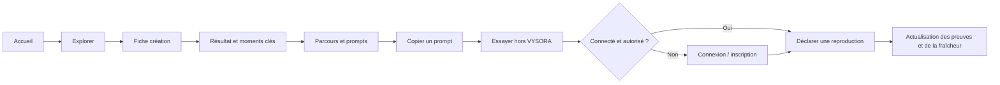
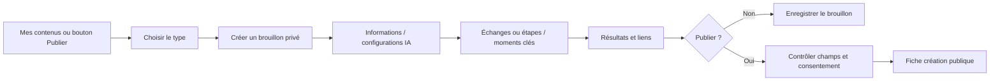
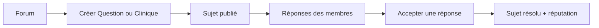
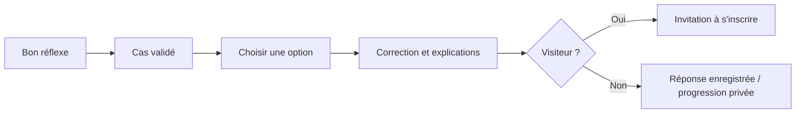
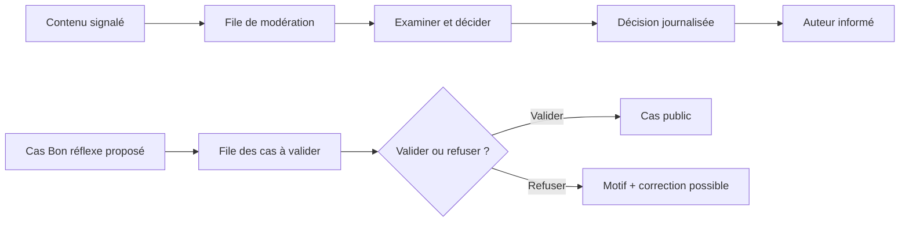

# VYSORA — Sitemap complet du MVP

| Métadonnée | Valeur |
| --- | --- |
| Projet | **VYSORA** |
| Document | Sitemap / plan de navigation du MVP |
| Version | 1.2 — défis en onglet de l'en-tête |
| Date | 16 octobre 2026 |
| Statut | À valider par l'équipe produit et technique |
| Périmètre | Application web responsive, MVP bêta fermée et ouverture publique |
| Diffusion | Interne à l'équipe projet |

> **Positionnement :** VYSORA permet de partager des créations réalisées avec l'IA, de montrer **comment** elles ont été réalisées (prompts, modèles, étapes et moments clés), de vérifier leur reproductibilité et d'apprendre grâce à la communauté.
>
> **Slogan :** Voir comment l'IA crée. Apprendre à créer avec elle.

## 1. Sources, conventions et périmètre

### 1.1 Documents de référence

1. `01-vision-et-objectifs.md` — mission, périmètre et feuille de route.
2. `02-cibles-et-objectifs.md` — segments, personas et rôles.
3. `03-fonctionnalites-mvp.md` — fonctionnalités F-xx, priorités et règles RG-xx.
4. `04-parcours-utilisateurs-et-workflows-mvp.md` — **26 écrans EC-01 à EC-26**, parcours PU-xx et workflows WF-xx.
5. `05-mcd-mvp.md` — entités métier et relations entre les contenus.
6. `06-charte-graphique.md` — identité visuelle et accessibilité.
7. `08-guide-redaction.md` — règles de rédaction des textes d'interface.

### 1.2 Ce qui est défini et ce qui est proposé

- **Écrans EC-xx, fonctionnalités F-xx et droits d'accès :** repris des documents de référence.
- **Routes URL, découpage en sous-pages, onglets et composants :** **propositions d'architecture front-end**. Les documents définissent des écrans, mais ne fixent pas leurs URL.
- **Pages légales publiques et écrans techniques :** routes d'implémentation recommandées pour matérialiser des exigences existantes ; elles ne constituent pas de nouvelles fonctionnalités métier.
- **MVP bêta fermée :** fonctionnalités **Must** uniquement ; accès sur invitation selon le document 01.
- **MVP ouverture publique :** fonctionnalités **Must + Should**.
- **Could / V2 / V3 :** hors de cette arborescence opérationnelle ; voir section 12.

**Légende :** `M` = Must, `S` = Should, `P` = public, `U` = membre connecté, `E` = expert ou plus, `MOD` = modérateur, `ADM` = administrateur. Les utilisateurs `MOD` et `ADM` conservent les accès publics et membres. Une fonctionnalité Should n'est pas un prérequis de la bêta fermée.

## 2. Arborescence générale du site

```text
VYSORA /
│
├── DÉCOUVRIR                                      [P]
│   ├── Accueil                                    /
│   ├── Explorer / Rechercher                      /explorer
│   │   ├── Résultats « Créations »                /explorer?type=creations
│   │   ├── Résultats « Sujets »                   /explorer?type=sujets
│   │   └── Résultats « Bon réflexe »              /explorer?type=bon-reflexe
│   ├── Catégorie                                  /categories/[slug]       [S]
│   ├── Étiquette                                  /etiquettes/[slug]       [S]
│   └── Fiche création                             /creations/[id]
│       ├── Résultat et contexte                   (section)
│       ├── Moments clés                           (section)
│       ├── Parcours : étapes/échanges/config.     (section)
│       ├── Reproductions et preuve                (section)
│       ├── Variantes                              (section)              [S]
│       ├── Commentaires                           (section)
│       └── Actions : copier, voter, reproduire,   (actions)
│           enregistrer, signaler, partager
│
├── FORUM                                          [P]
│   ├── Tous les sujets                            /forum
│   ├── Sujet / réponses                           /forum/[id]
│   └── Créer un sujet                             /forum/nouveau          [U]
│       ├── Question                               (?type=question)
│       ├── Clinique du prompt                     (?type=clinique)
│       ├── Astuce avant/après                     (?type=astuce)
│       ├── Retour d'expérience                    (?type=retour)
│       └── Discussion                             (?type=discussion)
│
├── APPRENDRE                                      [P]
│   ├── Bon réflexe : liste                        /bon-reflexe
│   ├── Bon réflexe : cas / correction             /bon-reflexe/[id]
│   ├── Proposer un cas                            /bon-reflexe/nouveau     [E/MOD]
│   └── Classements de réputation                  /classements            [S]
│
├── DÉFIS                                          [P]
│   ├── Tous les défis                             /defis                  [S]
│   ├── Défi : détail et participations            /defis/[id]             [S]
│   └── Participer à un défi                       /creations/nouvelle?defi=[id]  [U]
│
├── CRÉER / PUBLIER                                [U]
│   ├── Nouvelle création : choix du type          /creations/nouvelle
│   ├── Création « 1 prompt »                      /creations/nouvelle?type=prompt
│   ├── Création « Itération »                     /creations/nouvelle?type=iteration
│   ├── Création « Projet »                        /creations/nouvelle?type=projet
│   └── Reprendre / modifier un brouillon          /creations/[id]/modifier
│
├── ESPACE MEMBRE                                  [U]
│   ├── Profil public (tout utilisateur)           /membres/[pseudo]        [P]
│   ├── Mes contenus                               /mes-contenus
│   │   ├── Brouillons                             /mes-contenus?onglet=brouillons
│   │   ├── Publiés                                /mes-contenus?onglet=publies
│   │   └── Enregistrés                            /mes-contenus?onglet=enregistres [S]
│   ├── Notifications                              /notifications          [S]
│   └── Paramètres et mes données                  /parametres
│       ├── Compte et préférences                  /parametres/compte
│       ├── Comptes externes liés                  /parametres/connexions  [S]
│       ├── Exporter mes données                   /parametres/donnees
│       └── Supprimer mon compte                   /parametres/suppression
│
├── IDENTIFICATION ET CONFORMITÉ                   [visiteur / utilisateur]
│   ├── Connexion                                 /connexion
│   ├── Inscription                                /inscription
│   ├── Vérification de l'adresse e-mail           /verifier-email
│   ├── Mot de passe oublié                        /mot-de-passe-oublie
│   ├── Définir le nouveau mot de passe            /reinitialiser-mot-de-passe
│   ├── Consentement à une nouvelle version        /accepter-documents
│   ├── Conditions générales d'utilisation        /cgu
│   ├── Politique de confidentialité               /confidentialite
│   └── Charte communautaire                       /charte-communautaire
│
├── MODÉRATION                                      [MOD/ADM]
│   ├── File de signalements                      /moderation/signalements
│   ├── Traitement d'un signalement               /moderation/signalements/[id]
│   ├── Cas Bon réflexe à valider                  /moderation/cas
│   └── Examen d'un cas proposé                    /moderation/cas/[id]
│
└── ADMINISTRATION                                  [ADM]
    ├── Indicateurs du MVP                        /admin/indicateurs       [S]
    ├── Journal des décisions                     /admin/decisions
    ├── Référentiels                              /admin/referentiels
    │   ├── Éditeurs                              /admin/referentiels/editeurs
    │   ├── Outils IA                             /admin/referentiels/outils
    │   ├── Modèles IA                            /admin/referentiels/modeles
    │   ├── Catégories                            /admin/referentiels/categories
    │   ├── Étiquettes                            /admin/referentiels/etiquettes
    │   ├── Licences                              /admin/referentiels/licences
    │   ├── Badges                                /admin/referentiels/badges
    │   ├── Niveaux                               /admin/referentiels/niveaux
    │   └── Types de vote                         /admin/referentiels/types-vote
    ├── Rôles des membres                         /admin/roles
    ├── Défis : création et gestion               /admin/defis             [S]
    └── Documents légaux et versions              /admin/documents-legaux
```

**Important :** Les chemins `nouvelle` et `[id]` doivent être résolus sans ambiguïté dans le routeur. Les sections, onglets, filtres, modales et actions n'exigent pas nécessairement une page dédiée.

## 3. Inventaire des 26 écrans de référence

| Écran | Nom de référence | Route principale proposée | Accès | Priorité de l'écran / fonctions |
| --- | --- | --- | --- | --- |
| EC-01 | Accueil | `/` | P | **M** F-21 |
| EC-02 | Explorer / recherche | `/explorer` | P | **M** F-22 |
| EC-03 | Catégorie / étiquette | `/categories/[slug]`, `/etiquettes/[slug]` | P | **S** F-25 |
| EC-04 | Fiche création | `/creations/[id]` | P | **M** F-23, F-24, F-30, F-32, F-33, F-40 ; blocs **S** F-26, F-34, F-35, F-41, F-42 |
| EC-05 | Éditeur de création | `/creations/nouvelle`, `/creations/[id]/modifier` | U | **M** F-10 à F-17 ; options **S** F-18 à F-20, F-64 |
| EC-06 | Forum / liste | `/forum` | P | **M** F-50 |
| EC-07 | Sujet du forum | `/forum/[id]` | P | **M** F-51 à F-53, F-30, F-31 ; **S** F-54, F-55, F-35 |
| EC-08 | Éditeur de sujet | `/forum/nouveau` | U | **M** F-50, F-53 ; **S** F-54 |
| EC-09 | Bon réflexe / liste | `/bon-reflexe` | P | **M** F-62 |
| EC-10 | Cas Bon réflexe | `/bon-reflexe/[id]` | P | **M** F-62, F-30 |
| EC-11 | Éditeur de cas | `/bon-reflexe/nouveau` | E/MOD/ADM | **M** F-60 |
| EC-12 | Défis / liste et détail | `/defis`, `/defis/[id]` | P | **S** F-63 à F-65 |
| EC-13 | Classements | `/classements` | P | **S** F-75 |
| EC-14 | Profil public | `/membres/[pseudo]` | P | **M** F-05, F-73 ; **S** F-74 |
| EC-15 | Mes contenus | `/mes-contenus` | U | **M** F-16 ; **S** F-34 |
| EC-16 | Notifications | `/notifications` | U | **S** F-81 |
| EC-17 | Paramètres / mes données | `/parametres` et sous-routes | U | **M** F-06, F-07, F-08 ; **S** F-02 |
| EC-18 | Identification | `/connexion`, `/inscription`, récupération | Visiteur | **M** F-01, F-03, F-04 ; **S** F-02 |
| EC-19 | File de modération | `/moderation/signalements` | MOD/ADM | **M** F-91 ; **S** F-93 |
| EC-20 | Cas à valider | `/moderation/cas` | MOD/ADM | **M** F-61 |
| EC-21 | Journal des décisions | `/admin/decisions` | ADM | **M** F-92 |
| EC-22 | Référentiels | `/admin/referentiels` | ADM | **M** F-95 |
| EC-23 | Rôles | `/admin/roles` | ADM | **M** F-96 |
| EC-24 | Gestion des défis | `/admin/defis` | ADM | **S** F-63, F-65 |
| EC-25 | Documents légaux | `/admin/documents-legaux` | ADM | **M** F-04, F-95 |
| EC-26 | Indicateurs | `/admin/indicateurs` | ADM | **S** F-97 |

**Note de lecture :** un écran Must peut intégrer des actions Should sans que celles-ci deviennent obligatoires en bêta fermée. La séparation d'un écran en plusieurs URL, notamment EC-12, EC-17 ou EC-18, **ne change pas** le nombre de 26 écrans fonctionnels du document 04.

## 4. Pages publiques — contenu et actions

### EC-01 — Accueil (`/`) — Must

**Objectif :** faire comprendre immédiatement pourquoi VYSORA est utile et amener à découvrir une création documentée.

**Référence :** prototype `prototype/index.html`. Dans le prototype, chaque route correspond à un fichier `.html` (`/explorer` → `explorer.html`).

**Structure, dans l'ordre :**

1. **En-tête :** logo (lien vers l'accueil), navigation Explorer, Forum, Apprendre, Défis **[S]**, Classements ; recherche ; Publier ; Se connecter ; S'inscrire.
2. **Héros :** titre « Voir comment l'IA crée. Apprendre à créer avec elle. », présentation, recherche d'intention (« Que voulez-vous créer ? ») avec suggestions fréquentes, vitrine « rayons X » qui fait passer trois créations du résultat à la méthode, chiffres clés (créations documentées, reproductions déclarées, questions résolues, outils et modèles référencés).
3. **Outils :** sphère abstraite des 64 outils référencés, filtrable par famille (Assistants, Image, Vidéo, Audio, Code, Automatisation) ; fond clair, image de fond réglable dans les Tweaks ; catalogue affiché progressivement, liste complète pour les lecteurs d'écran.
4. **Le constat :** comparateur à curseur entre une publication sur un réseau social et la même création sur Vysora ; trois chiffres sourcés (Stack Overflow 2025, Veracode 2025, Anthropic 2026) avec lien vers chaque source.
5. **La méthode :** section épinglée au défilement qui présente les cinq couches d'une fiche (résultat, parcours, moments clés, configuration, preuve) ; indication de défilement, étapes cliquables, lien « Passer à la suite ».
6. **Du prompt au projet :** les trois formats « 1 prompt », « Itération » et « Projet », chacun avec un schéma, une description et un exemple ; rappel que seuls « 1 prompt » et « Itération » se reproduisent.
7. **À explorer :** créations reliées en parcours, onglets Plus utiles (votes « Utile » des 7 derniers jours), Nouveautés et Plus reproduites ; accès par domaine et lien vers toutes les créations.
8. **Apprendre :** laboratoire à onglets. Bon réflexe : cas jouable, choix au clavier et correction. Clinique du prompt : prompt avant/après annoté. Défi de la semaine **[S]** : règles, participants, compte à rebours, « Participer au défi ». L'ancre `#defis` ouvre l'onglet Défi.
9. **La communauté :** fil des dernières contributions (avec pause), courbe des interactions d'apprentissage sur les 3 dernières semaines, répartition par type d'interaction, questions sans réponse, astuce de la semaine avec exemple avant/après.
10. **Pour vous :** photo de fond et trois profils en onglets (Je débute, J'utilise l'IA au quotidien, Je maîtrise l'IA) : progression, filtres et compatibilité testée par modèle, profil vérifiable avec badges.
11. **Progresser :** niveaux, barème des points, classement de la semaine **[S]**, badges **[S]** avec leur critère d'obtention.
12. **Nos engagements :** six principes appliqués à chaque fonctionnalité.
13. **Questions fréquentes :** gratuité, outils, visibilité des créations, publication, fraîcheur d'une méthode, licence (CC BY 4.0 par défaut).
14. **Appel final :** « Créer un compte gratuit » et « Explorer les créations ».
15. **Pied de page sombre :** voir section 10.2.

Les blocs Apprendre et La communauté couvrent le défi en cours **[S]**, les questions et cliniques sans réponse et les cas Bon réflexe à découvrir. L'invitation à s'inscrire figure dans l'en-tête, dans Pour vous et dans l'appel final.

**Réglages Tweaks de la page :** héros, couleur d'accent, sections contrastées, fond de la section Outils, cartes des créations, intertitres, densité, arrondis, intensité des effets, animations.

**Navigation sortante :** `/explorer` (avec `?q=`), `/creations/[id]`, `/forum` (avec `?type=clinique`), `/bon-reflexe`, `/classements` **[S]**, `/creations/nouvelle`, `/connexion`, `/inscription`, `/cgu`, `/confidentialite`, `/charte-communautaire` ; `/defis` et `/defis/[id]` lorsque F-63 est activée.

### EC-02 — Explorer (`/explorer`) — Must

**Objectif :** retrouver rapidement une méthode ou un contenu adapté à un besoin concret.

- Champ de recherche et onglets **Créations / Sujets / Bon réflexe**.
- Filtres combinables : type de création, catégorie, outil, éditeur, modèle, étiquette, date, présence de moments clés, reproduction réussie.
- Tris : pertinence, récence, votes Utile, reproductions réussies.
- Cartes de résultats avec titre, auteur, type, outil/modèle, date, indicateurs pertinents.
- État « aucun résultat » avec action pour retirer les filtres.
- URL partageable préservant la recherche et les filtres (convention technique proposée).

**Navigation sortante :** `/creations/[id]`, `/forum/[id]`, `/bon-reflexe/[id]`.

### EC-03 — Catégorie ou étiquette — Should

**Routes :** `/categories/[slug]`, `/etiquettes/[slug]`.

- Nom de la catégorie/étiquette et liste des contenus associés.
- Ordre initial : contenus les plus utiles.
- Filtres de recherche disponibles comme sur EC-02.
- Liens vers les créations, sujets et cas associés.

### EC-04 — Fiche création (`/creations/[id]`) — Must

**Objectif :** montrer **le résultat, puis le raisonnement et les choix humains** qui ont mené à ce résultat.

**Ordre recommandé, défini par F-23 :**

1. **En-tête :** titre, auteur/niveau, type (« 1 prompt », « Itération », « Projet »), catégorie, étiquettes, licence, dates.
2. **Résultat :** réponse obtenue, captures/images, liens externes (démo, dépôt, vidéo, preuve, article).
3. **Moments clés :** synthèse des corrections, refus, erreurs, vérifications et changements décisifs.
4. **Parcours documenté :** étapes, outil, modèle, paramètres, contexte caché, prompts et réponses ; blocs dépliables, avec bouton « Copier le prompt ».
5. **Preuve et fraîcheur :** reproductions, taux de succès (si au moins 3), dernière reproduction, modèles testés, dates ; avertissements éventuels.
6. **Reproductions :** retours d'expérience de membres ayant réellement essayé (pour « 1 prompt » et « Itération » uniquement).
7. **Variantes :** création source, crédits et créations dérivées **[S]**.
8. **Commentaires :** liste, formulaire de commentaire ; ancrage à une étape ou un échange et réponses **[S]**.

**Actions contextuelles :** voter « Utile », « J'ai essayé », copier un prompt, commenter, enregistrer **[S]**, signaler l'obsolescence **[S]**, partager **[S]**, signaler un contenu. Pour l'auteur : modifier, dépublier, supprimer. Pour un membre tiers : proposer une variante si la licence le permet **[S]**.

**Règles :** un projet de type « Projet » n'est **pas** reproductible via F-32 ; les projets longs replient leurs échanges ; un prompt est seulement copié, **jamais exécuté sur VYSORA**.

### EC-06 — Forum (`/forum`) — Must

- Liste des sujets publiés et visibles.
- Distinction par type : **Question**, **Clinique du prompt**, **Astuce**, **Retour d'expérience**, **Discussion**.
- Statuts utiles : ouvert/fermé, résolu/non résolu pour questions et cliniques.
- Accès à « Poser une question », « Ouvrir une clinique », « Partager une astuce ».
- Accès à la fiche d'un sujet.

### EC-07 — Détail d'un sujet (`/forum/[id]`) — Must

- Titre, type, auteur, date, étiquettes, éventuelle création associée **[S]**.
- Corps du sujet et contenus spécifiques au type : quatre rubriques de la Clinique ou exemple **avant/après** pour l'Astuce.
- Liste des réponses ; possibilité de répondre tant que le sujet est ouvert.
- Pour Question et Clinique : bouton **« Accepter cette réponse »** réservé à l'auteur ; une réponse acceptée à la fois et sujet marqué Résolu.
- Votes « Utile » sur les sujets/réponses ; « Testé, ça marche » uniquement sur les astuces.
- Signalement d'obsolescence pour les astuces **[S]**.
- Actions : fermer/rouvrir **[S]**, signaler, enregistrer **[S]**, partager **[S]**.

### EC-09 — Liste Bon réflexe (`/bon-reflexe`) — Must

- Cas d'entraînement **validés** accessibles au public.
- Titre, difficulté (Débutant, Intermédiaire, Avancé), thème/étiquettes.
- Invitation à ouvrir un cas et à juger une réponse de l'IA.
- Pour un membre autorisé : lien « Proposer un cas ».

### EC-10 — Cas Bon réflexe (`/bon-reflexe/[id]`) — Must

- Contexte de la situation, demande faite à l'IA et réponse fournie par l'IA.
- Question à l'apprenant et **2 à 5 choix** (une seule réponse correcte).
- Après le choix : bonne réponse, explication de chaque option, explication générale et répartition des réponses de la communauté.
- Membre : première réponse enregistrée et **définitive** ; l'auteur du cas ne peut pas y répondre.
- Visiteur : réponse possible **sans sauvegarde**, avec invitation à créer un compte.
- Vote « Utile » autorisé selon les règles de vote.

### EC-12 — Défis (`/defis`, `/defis/[id]`) — Should

**Accès :** onglet **Défis** de l'en-tête, entre Apprendre et Classements, sur toutes les pages ; lien Défis du pied de page ; « Participer au défi » depuis l'accueil et les classements.

**Liste des défis :** défis publiés, période, état et lien de détail.

**Fiche défi :** titre, objectif, contraintes, dates, participations, créations associées et classement **figé** après clôture. CTA « Participer » qui mène à l'éditeur de création (`/creations/nouvelle?defi=[id]`) en rattachant la création au défi.

**Règles :** seuls les administrateurs créent/publient/clôturent un défi ; un membre ne soumet qu'une création par défi ; participation pendant sa période.

### EC-13 — Classements (`/classements`) — Should

- Classement hebdomadaire des membres.
- Classement général.
- Jusqu'à **50 membres** par classement.
- Liens vers les profils publics et informations de réputation.

### EC-14 — Profil public (`/membres/[pseudo]`) — Must

- Pseudo, avatar, biographie, lien personnel.
- Niveau et réputation.
- Badges obtenus **[S]**.
- Statistiques publiques : créations publiées, reproductions reçues et taux de succès, réponses acceptées, votes « Utile » reçus, vues cumulées.
- Créations publiées et contributions publiques récentes.
- **Si propriétaire connecté :** accès aux paramètres et statistiques d'apprentissage privées (cas répondus/réussis, reproductions déclarées), sans les dévoiler aux visiteurs.
- Partager le lien vers le profil **[S]**.

## 5. Création et publication — pages membres

### EC-05 — Éditeur de création — Must (avec options Should)

**Routes proposées :**

- `/creations/nouvelle` : choix du type.
- `/creations/nouvelle?type=prompt` : création « 1 prompt ».
- `/creations/nouvelle?type=iteration` : création « Itération ».
- `/creations/nouvelle?type=projet` : création « Projet ».
- `/creations/[id]/modifier` : modification/reprise d'un brouillon de l'auteur.

**Structure commune de l'éditeur :**

1. **Informations générales :** titre, objectif, type, catégorie, étiquettes, licence.
2. **Configurations IA :** outil (obligatoire pour une configuration), modèle référencé ou modèle saisi en texte libre s'il n'existe pas, paramètres, contexte caché.
3. **Parcours :** prompts/réponses, échanges ordonnés ou étapes ordonnées, selon le type.
4. **Moments clés :** type d'intervention humaine (correction, refus, échec, changement d'outil, vérification, découverte) et justification.
5. **Résultats et preuves :** images, liens HTTPS typés (démo, dépôt, vidéo, preuve, article, autre), limites constatées.
6. **Validation :** contrôles des champs, avertissements de données sensibles **[S]**, indicateur « instructions pour agent » **[S]**, confirmation explicite avant publication.
7. **Actions :** enregistrer le brouillon, publier, modifier, dépublier, supprimer. Le type est non modifiable après la première publication.

| Type | Forme du parcours | Minimum pour publier | Spécificité |
| --- | --- | --- | --- |
| **1 prompt** (F-10) | Exactement **1 étape, 1 échange** | Prompt et réponse textuelle **ou image** ; nombre d'essais et mode de sélection | Montrer comment un résultat a été obtenu en une demande |
| **Itération** (F-11) | Exactement **1 étape**, au moins **2 échanges** | Chaque échange a un prompt ; le dernier a une réponse ou une image | Montrer comment l'auteur a corrigé l'IA au fil des échanges |
| **Projet** (F-12) | Au moins **2 étapes** | Titre + récit pour chaque étape ; résultat final par image ou lien externe | Montrer une méthode complète, avec configurations et échanges clés facultatifs selon les étapes |

**Informations complémentaires :** la création **commence en brouillon privé** ; les variantes **[S]** réutilisent type, catégorie et configuration de la source lorsque sa licence l'autorise ; participation à un défi **[S]** à sélectionner dans l'éditeur, ou déjà sélectionnée à l'arrivée depuis un défi (`?defi=[id]`).

### EC-08 — Éditeur de sujet (`/forum/nouveau`) — Must

- Sélection du type de sujet : Question, Clinique, Astuce, Retour d'expérience, Discussion.
- Titre, texte, étiquettes et éventuelle création liée **[S]**.
- **Clinique du prompt :** rubriques obligatoires « prompt utilisé », « résultat obtenu », « résultat attendu », « outil et modèle ».
- **Astuce :** champs obligatoires « Exemple avant » et « Exemple après ».
- Aperçu et action « Publier ».
- Route dédiée à l'édition ultérieure d'un sujet **non imposée** par les documents ; à valider avant implémentation.

### EC-11 — Proposer un cas (`/bon-reflexe/nouveau`) — Must

- Accès : niveau **Expert ou supérieur**, modérateur ou administrateur.
- Titre, contexte, demande adressée à l'IA, réponse de l'IA, question posée au lecteur.
- **2 à 5 options**, une seule correcte ; explication de chaque option et explication générale.
- Difficulté et étiquettes.
- Action **« Soumettre à validation »** ; statut `PROPOSE`.
- Si refus : motif affiché ; l'auteur peut corriger et soumettre à nouveau (même écran de formulaire, éventuellement `/bon-reflexe/[id]/modifier`, route technique proposée).

## 6. Espace personnel du membre

### EC-15 — Mes contenus (`/mes-contenus`) — Must

| Onglet | Affichage | Actions |
| --- | --- | --- |
| **Brouillons** | Créations en cours, privées | Continuer à modifier, publier, supprimer |
| **Publiés** | Créations publiées par le membre | Ouvrir, modifier, dépublier, supprimer |
| **Enregistrés [S]** | Créations, sujets et cas mis de côté | Consulter, retirer des enregistrés |

**Attention :** les documents définissent cet écran sous le nom « Mes contenus (brouillons, publiés, enregistrés) ». Ils n'imposent pas de tableau de bord personnel supplémentaire.

### EC-16 — Notifications (`/notifications`) — Should

- Notifications non lues/lues avec compteur.
- Événements : commentaires, réponses, réponses acceptées, reproduction, variante, obsolescence, badge, niveau, décision de modération, cas validé/refusé, résultats de défi, etc.
- Ouverture du contenu concerné et marquage comme lu.
- Préférence d'e-mail pour certains événements depuis les paramètres.

### EC-17 — Paramètres et mes données (`/parametres`) — Must

| Sous-section proposée | Route | Fonctions |
| --- | --- | --- |
| **Compte et préférences** | `/parametres/compte` | E-mail (nouvelle vérification), mot de passe, langue, préférences d'e-mail : F-06 |
| **Connexions externes [S]** | `/parametres/connexions` | Lier GitHub/Google : F-02 |
| **Mes données** | `/parametres/donnees` | Demander l'export JSON, suivre la mise à disposition et télécharger pendant 7 jours : F-07 |
| **Suppression de compte** | `/parametres/suppression` | Demande confirmée, choix concernant la suppression des créations, période de rétractation de 30 jours : F-08 |

> Pour conserver l'accès au contenu demandé par EC-17, `/parametres` peut afficher directement « Compte et préférences » ou rediriger vers `/parametres/compte`.

## 7. Authentification et pages légales

### EC-18 — Identification — Must

| Écran / état | URL proposée | Comportement attendu |
| --- | --- | --- |
| **Inscription** | `/inscription` | Pseudo, e-mail, mot de passe, acceptation des trois documents légaux et validation |
| **Connexion** | `/connexion` | Identifiants, déconnexion ensuite depuis le menu membre |
| **Vérification d'e-mail** | `/verifier-email` | Confirmer l'adresse ou renvoyer le lien expiré (24 h) |
| **Mot de passe oublié** | `/mot-de-passe-oublie` | Saisir son e-mail sans révéler si le compte existe |
| **Réinitialisation** | `/reinitialiser-mot-de-passe` | Consommer le lien valable une heure et définir un nouveau mot de passe |
| **GitHub / Google [S]** | État ou action depuis `/connexion` / `/inscription` | Autorisation OAuth, choix d'un pseudo et acceptation des documents à la première connexion |
| **Nouveaux documents à accepter** | `/accepter-documents` | Accuser réception et accepter les versions entrées en vigueur avant de contribuer |

**Routes publiques recommandées pour les trois documents versionnés obligatoires (F-04) :**

- `/cgu` — Conditions générales d'utilisation.
- `/confidentialite` — Politique de confidentialité.
- `/charte-communautaire` — Charte communautaire.

Les URL sont proposées ; **l'existence et l'acceptation versionnée des trois documents** sont obligatoires. Une page « Mentions légales » peut être ajoutée après validation des obligations juridiques applicables, mais elle **n'est pas explicitement spécifiée comme écran EC dans les sources**.

## 8. Modération

### EC-19 — File de modération (`/moderation/signalements`) — Must

- Liste des signalements ouverts avec contenu concerné, auteur, motifs, nombre de signalements et ancienneté.
- Ordre initial : du plus ancien au plus récent.
- Priorisation visuelle des contenus masqués automatiquement **[S]**.
- Ouverture d'un dossier de signalement via `/moderation/signalements/[id]` (route technique proposée dans le même écran EC-19).
- **Décisions :** aucune action, masquer, rétablir, supprimer, avertir, suspendre (1 à 90 jours), ajouter/retirer l'avertissement « instructions pour agent » **[S]** ; motif obligatoire.
- Les décisions sont journalisées et immuables ; les signalements correspondants sont clos.
- Interdiction de traiter un contenu dont le modérateur est l'auteur.
- Actions additionnelles **ADM uniquement :** bannir, ajuster la réputation (fraude avérée), retirer un badge.

### EC-20 — Validation de cas (`/moderation/cas`) — Must

- Liste des cas Bon réflexe au statut `PROPOSE`.
- Examen détaillé d'un cas via `/moderation/cas/[id]` (route technique proposée).
- Décisions **« Valider »** ou **« Refuser »** (avec motif obligatoire).
- Un modérateur ne valide pas son propre cas ; le cas refusé est corrigible puis soumis à nouveau.
- Le cas validé devient visible dans `/bon-reflexe`.

## 9. Administration

### EC-21 — Journal des décisions (`/admin/decisions`) — Must

- Consultation des décisions de modération, non modifiables.
- Filtres : modérateur, membre, action, période.
- Traçabilité des actions et motifs, consultation du contexte.

### EC-22 — Référentiels (`/admin/referentiels`) — Must

| Sous-section | URL proposée | Entité / fonction |
| --- | --- | --- |
| Éditeurs | `/admin/referentiels/editeurs` | Éditeurs d'outils / modèles |
| Outils | `/admin/referentiels/outils` | Outils IA |
| Modèles | `/admin/referentiels/modeles` | Modèles IA et versions |
| Catégories | `/admin/referentiels/categories` | Types de résultats de création |
| Étiquettes | `/admin/referentiels/etiquettes` | Tags thématiques |
| Licences | `/admin/referentiels/licences` | Licences proposées aux auteurs |
| Badges | `/admin/referentiels/badges` | Critères et types de badges |
| Niveaux | `/admin/referentiels/niveaux` | Paliers de réputation |
| Types de vote | `/admin/referentiels/types-vote` | Types et applicabilité des votes |

**Actions communes :** créer, modifier, archiver. Un élément référencé par des contenus existants est **archivé, pas supprimé**. Les documents légaux sont administrés sur EC-25 même s'ils sont également un référentiel au sens de F-95.

### EC-23 — Gestion des rôles (`/admin/roles`) — Must

- Trouver un membre et consulter son rôle.
- Attribuer/retirer **Modérateur** ou **Administrateur**.
- Journalisation des changements.
- Empêcher la suppression du dernier administrateur actif.
- Authentification renforcée (double facteur) obligatoire pour les comptes MOD et ADM selon ENF-05 ; le parcours exact de configuration 2FA est **à préciser techniquement**.

### EC-24 — Gestion des défis (`/admin/defis`) — Should

- Créer un défi en brouillon (titre, énoncé, contraintes, date de début et de fin).
- Publier, annuler et clôturer dans le respect des statuts.
- Consulter les participations et, après clôture, le classement figé.
- Détail ou formulaire de défi : une sous-route `/admin/defis/[id]` est envisageable, sans créer d'écran métier additionnel.

### EC-25 — Documents légaux (`/admin/documents-legaux`) — Must

- Gérer les versions des CGU, de la politique de confidentialité et de la charte communautaire.
- Date de prise d'effet des nouvelles versions.
- Conserver les versions antérieures et les acceptations enregistrées.
- Déclencher la nécessité de réacceptation lors de l'entrée en vigueur de la nouvelle version.

### EC-26 — Indicateurs (`/admin/indicateurs`) — Should

- Indicateur North Star : **interactions d'apprentissage hebdomadaires**.
- Indicateurs O-01 à O-08 du document 01.
- Évolution hebdomadaire et mensuelle, comparaison aux objectifs.
- Réservé aux administrateurs.

## 10. Navigation, rôles et règles transversales

### 10.1 Menu principal proposé

| Position | Libellé | Destination | Visiteur | Membre | MOD | ADM |
| --- | --- | --- | --- | --- | --- | --- |
| En-tête | **Logo VYSORA** (lien vers l'accueil) | `/` | Oui | Oui | Oui | Oui |
| En-tête | **Explorer** | `/explorer` | Oui | Oui | Oui | Oui |
| En-tête | **Forum** | `/forum` | Oui | Oui | Oui | Oui |
| En-tête | **Apprendre** | `/bon-reflexe` | Oui | Oui | Oui | Oui |
| En-tête | **Défis [S]** | `/defis` | Oui | Oui | Oui | Oui |
| En-tête | **Classements [S]** | `/classements` | Oui | Oui | Oui | Oui |
| En-tête | **Recherche** (icône) | `/explorer` | Oui | Oui | Oui | Oui |
| Action principale | **Publier** | `/creations/nouvelle` | Redirection connexion | Oui | Oui | Oui |
| Zone compte | **Se connecter / S'inscrire** | `/connexion`, `/inscription` | Oui | Non | Non | Non |
| Zone compte | **Mon profil** | `/membres/[pseudo]` | Non | Oui | Oui | Oui |
| Zone compte | **Mes contenus** | `/mes-contenus` | Non | Oui | Oui | Oui |
| Zone compte | **Notifications [S]** | `/notifications` | Non | Oui | Oui | Oui |
| Zone compte | **Paramètres** | `/parametres` | Non | Oui | Oui | Oui |
| Zone rôle | **Modération** | `/moderation/signalements` | Non | Non | Oui | Oui |
| Zone rôle | **Administration** | `/admin/referentiels` (ou autre sous-page) | Non | Non | Non | Oui |

**Sur mobile :** le menu reprend Explorer, Forum, Apprendre, Défis, Classements et « Publier une création », suivis de « S'inscrire » et « Se connecter » ; la recherche reste accessible depuis l'en-tête. Ne pas afficher de liens MOD/ADM à un utilisateur sans autorisation. **La vérification des permissions se fait également côté serveur : masquer un lien ne protège pas une route.**

### 10.2 Pied de page proposé

- Logo VYSORA et slogan, sur fond sombre.
- **Découvrir :** Explorer, Classements **[S]**, Défis **[S]**.
- **Apprendre :** Bon réflexe, Clinique du prompt, Forum.
- **Participer :** Publier une création, Créer un compte, Se connecter.
- **Informations :** CGU, politique de confidentialité, charte communautaire.
- Lien « Haut de page ».
- Mentions légales et contact **si validés et spécifiés ultérieurement** ; non requis comme écran EC par les sources.

### 10.3 Matrice simplifiée d'accès

| Fonction | Visiteur | Membre actif vérifié | Expert ou plus | MOD | ADM |
| --- | --- | --- | --- | --- | --- |
| Consulter contenus publics et profils | Oui | Oui | Oui | Oui | Oui |
| Chercher, filtrer, copier un prompt | Oui | Oui | Oui | Oui | Oui |
| Répondre à Bon réflexe | Oui, sans enregistrer | Oui, enregistré | Oui, sauf son cas | Oui, sauf son cas | Oui, sauf son cas |
| Publier créations et sujets | Non | Oui, selon limites de niveau | Oui | Oui | Oui |
| Voter, reproduire, commenter | Non | Oui, selon les règles | Oui | Oui | Oui |
| Proposer un cas Bon réflexe | Non | Non avant Expert | Oui | Oui | Oui |
| Modérer les signalements | Non | Non | Non | Oui, sauf ses contenus | Oui |
| Valider des cas | Non | Non | Non | Oui, sauf ses cas | Oui, selon les règles |
| Gérer défis, rôles et référentiels | Non | Non | Non | Non | Oui |
| Journal général et indicateurs | Non | Non | Non | Non | Oui |

**États particuliers :**

- **E-mail non vérifié :** lecture seule, invitation à vérifier l'adresse avant toute contribution (RG-02).
- **Documents légaux non réacceptés :** lecture seule jusqu'à nouvelle acceptation (F-04).
- **Compte suspendu :** lecture publique et accès aux paramètres, mais publication/interactions bloquées pendant la suspension (RG-103).
- **Compte banni :** accès du compte fermé.
- **Contenu en brouillon :** auteur uniquement ; contenu masqué : auteur (avec mention) et modération (RG-30).

## 11. Parcours de navigation clés

### 11.1 Découvrir, comprendre puis reproduire



### 11.2 Publier et partager un parcours



### 11.3 Obtenir de l'aide par le forum



### 11.4 Apprendre à exercer son jugement



### 11.5 Cycle de validation et modération



## 12. Contenus hors périmètre : ne pas ajouter au MVP

| Fonctionnalité / page éventuelle | Statut dans les documents | Conséquence sitemap |
| --- | --- | --- |
| **Carnéo**, capture automatique du parcours | **V2** | Aucune page opérationnelle Carnéo au MVP |
| Revue de méthode par un expert | V2 | Pas de workflow de revue |
| Parcours guidés | V2 | Pas de parcours pédagogique personnalisé |
| Profil de méthode | V2 | Pas de page de profil de méthode distincte |
| Abonnement à un membre | V2 | Pas de page Abonnements |
| Types « Agent » et « Chaîne d'outils » autonomes | V2 | Utiliser les trois types existants |
| Historique des versions de création | V2 | Pas de page d'historique |
| Records détaillés | Could / V2 selon la feuille de route | Pas de page Records MVP |
| Proposer un outil/modèle manquant | Could (F-98) | Saisie libre du modèle absent, pas de workflow requis |
| Ouvrir directement le prompt dans l'outil IA | Could (F-27) | Copier le prompt suffit |
| Messagerie privée | Hors MVP | Pas de boîte de réception privée |
| Application mobile native | Hors MVP | Site web responsive uniquement |
| Hébergement de vidéos / exécution IA | Hors MVP | Liens externes uniquement, aucune exécution de prompt |
| Marketplace payante | Exclue durablement | Aucune page achat/paiement |
| Espace écoles/formateurs, bilans par modèle, formats ouverts import/export | V3 | Aucune page dédiée au MVP |

## 13. Écrans et états techniques à anticiper (sans nouveaux écrans métier)

Ces éléments sont indispensables à une expérience utilisable, mais ne constituent pas des fonctionnalités F-xx supplémentaires :

- **403 / accès refusé :** rôle insuffisant, niveau insuffisant ou action interdite ; proposition de retour à une page autorisée.
- **404 / contenu introuvable :** identifiant inconnu, création supprimée, profil indisponible ou route invalide.
- **Erreur technique :** message clair, lien de retour, possibilité de réessayer sans perdre inutilement les saisies.
- **Chargement / liste vide / aucun résultat :** pour les recherches, contenus, notifications, signalements et référentiels.
- **Actions nécessitant confirmation :** publier, dépublier, supprimer, signaler, accepter une réponse, rendre une décision de modération, supprimer un compte.
- **Liens expirés :** vérification d'e-mail et réinitialisation de mot de passe avec possibilité de renouvellement.
- **Droits et confidentialité :** ne jamais exposer des brouillons, données privées ou dossiers MOD/ADM par le simple fait de connaître une URL.
- **Retour après connexion :** reprendre l'action commencée depuis une fiche ou un sujet lorsque c'est pertinent.

## 14. Cohérence visuelle (document 06)

| Élément | Règle VYSORA |
| --- | --- |
| Fond dominant | Blanc `#FFFFFF` |
| Couleur principale / CTA | Bleu `#2563EB` |
| Survol / état actif | Bleu foncé `#1D4ED8` |
| Fond de sélection | Bleu pâle `#EFF6FF` |
| Texte principal | Noir `#000000` / `#171717` |
| Séparateurs | Gris `#E5E5E5` |
| Texte secondaire | Gris `#737373` |
| Titres / marque | **Montserrat Alternates** |
| Interface et contenu | **Montserrat** |
| Responsive | Ordinateur, tablette, mobile |
| UX | Lisibilité, navigation prévisible, focus clavier visible, contrastes suffisants |

L'interface doit rester claire, sobre et accueillante pour les débutants ; aucun dégradé ni effet néon décoratif. Les actions de création, de copie, de reproduction et de correction doivent être immédiatement compréhensibles. Les règles d'interface validées de la section 13 de la charte s'appliquent à tous les écrans.

## 15. Ordre de réalisation recommandé

> **Proposition d'ordonnancement technique**, pas une modification des priorités MoSCoW du document 03.

| Lot | Écrans principaux | Résultat attendu |
| --- | --- | --- |
| **1 — Fondations** | EC-18, EC-17 (compte/conformité), EC-14 | S'inscrire, vérifier, se connecter, gérer son compte, afficher un profil |
| **2 — Valeur centrale** | EC-05, EC-15, EC-04 | Publier des parcours documentés et les consulter |
| **3 — Découverte et preuve** | EC-01, EC-02, EC-04 | Trouver, copier, reproduire, voter et commenter |
| **4 — Entraide et apprentissage** | EC-06 à EC-11, EC-20 | Forum, Clinique du prompt, Bon réflexe avec validation |
| **5 — Gouvernance Must** | EC-19, EC-21, EC-22, EC-23, EC-25 | Modération, rôles, référentiels, conformité |
| **6 — Compléments Should** | EC-03, EC-12, EC-13, EC-16, EC-24, EC-26 + actions Should dans les autres écrans | Ouverture publique avec catégories, défis, progression visible, notifications, indicateurs |

### Critères de cohérence avant développement

- [ ] Les **26 écrans EC-01 à EC-26** ont un point d'entrée dans l'architecture.
- [ ] Les 11 épopées E1 à E11 et les **61 fonctionnalités (41 Must / 20 Should)** ont une place (page, section ou action).
- [ ] Les routes sont cohérentes et ne confondent pas un onglet, une action et une vraie page.
- [ ] Chaque route protégée vérifie le rôle, l'état du compte et les règles pertinentes côté serveur.
- [ ] Les types « 1 prompt », « Itération », « Projet » disposent d'un éditeur adapté sans inventer de nouveaux types.
- [ ] La preuve de reproduction ne s'applique qu'aux créations « 1 prompt » et « Itération ».
- [ ] Les cas Bon réflexe publiés ont été validés et les droits des modérateurs sont respectés.
- [ ] Les trois documents légaux versionnés sont disponibles et acceptés.
- [ ] Aucun écran V2/Carnéo n'est présenté comme une fonctionnalité MVP disponible.
- [ ] Le design suit `06-charte-graphique.md`.

---

**Fin du sitemap VYSORA — MVP.**

*Ce document complète le plan de navigation du document 04 : les écrans, fonctionnalités et règles sont fondés sur les sources ; les URL et certaines subdivisions sont proposées et restent à valider avant le développement.*
